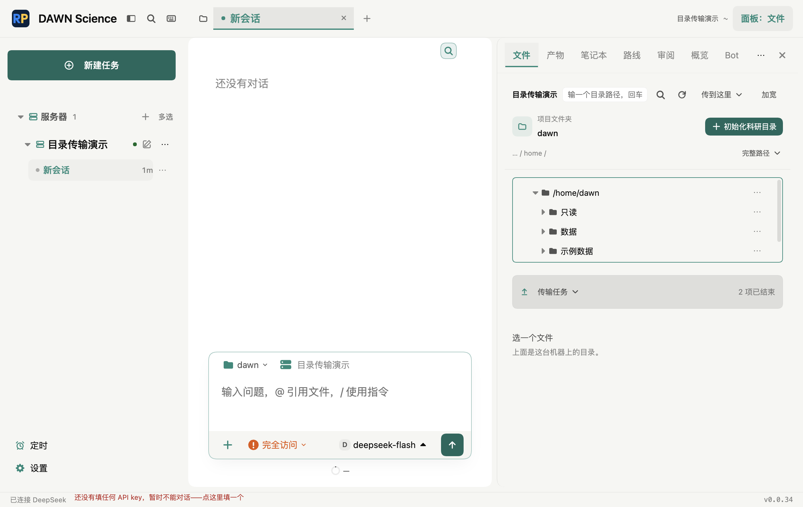
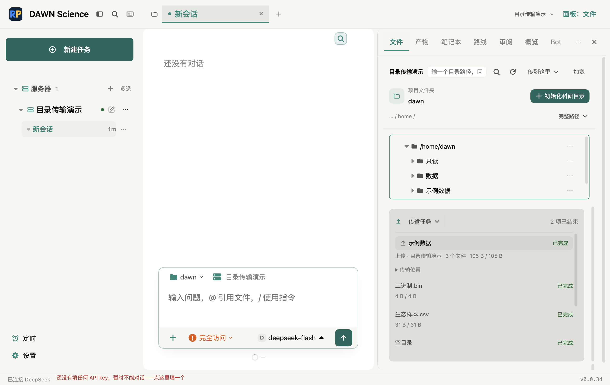

# SSH 目录批量传输：分支预览验收

日期：2026-10-21，Asia/Shanghai。基线 `b537c8e554f2962863e479932799572c4c79676b`，版本0.0.34。

分支：`codex/ssh-data-transfer`。工作树：`/Users/liuyue/.codex/worktrees/ssh-data-transfer/dawn-science`。

## 用户确认与最终界面

用户最初授权在新分支实施、打开实际预览，预览阶段不合并、不推送。随后明确授权「核对一下功能，没有问题，我们就提交，合并入main」；本次集成仅限本地，仍不推送。首版常驻统计和长路径被用户否定；已按随后确认的方向重做：

- 沿用原文件工具栏；「传到这里」下拉包含文件与文件夹上传，目录下载放在原目录操作菜单。
- 树根可以下载，新增菜单不会开放删除正在查看的根目录。
- 沿用原xfer表面、主题和字体；默认仅底部单条摘要，实际预览高度53.59375 CSS px。
- 点击摘要展开批次，再点任务展开逐文件状态；完整路径在「传输位置」中单独展开，不常驻占据文件树。
- 关闭面板、切聊天不终止任务；重新打开可查询结果。功能数据和任务身份归后端，不依赖当前面板选择。

实际窗口证据：

## 已交付行为

| 能力 | 实现与证据 |
|---|---|
| 目录上下行 | 本地/SFTP递归枚举；保留空目录、零字节、Unicode和二进制；Electron实际落盘逐字节比较 |
| 并发与结果 | 每服务器最多三条文件流，大于8MiB的文件最多一条；大小阈值为保守初始值，无公网吞吐提升结论；目录/文件状态与错误分别保存 |
| 失败和取消 | 扫描可取消；取消停止新调度并清理当前part，已完成文件保留；清理失败附残留路径；失败、取消和中断不混称 |
| 重试和冲突 | 只重新排入失败/中断/取消项；源发生可检测变化时拒绝上传；目标存在时等待逐项覆盖/另存/跳过，覆盖需再次明确确认 |
| 安全提交 | 远端覆盖使用POSIX rename扩展，失败不先unlink旧目标；下载批次使用排他提交，传输期间新出现的同名文件保留 |
| 完整性边界 | 提交前比较字节数、大小和可检测修改时间，能拒绝短读和源变化；没有宣称内容哈希校验或断点续传 |
| 连接与超时 | SSH keepalive；元数据15秒、传输无进展60秒超时；不把科研远端命令改成默认超时，不自动重连重放 |
| 恢复与存储 | JSON只含任务描述/结果，不含凭证；正常关闭等待取消和结果落盘；重启未终结项改interrupted，不自动开始。强制退出时最后未最终确认的文件可能需要人工核实/处理冲突 |
| 原有功能 | 保留单文件协议；多文件选择等待实际完成再发起下一文件，避免覆盖进度跟踪 |

扫描限制：10,000条目、64层；符号链接和特殊文件明确跳过，不悄悄跟随。不做同步删除。任务记录保留供查看，不自动清理用户文件。

## 测试证据

1. 全量单测：`npm test`，448个文件，**4879 passed / 10 skipped**（4889项）。原始输出 `/tmp/dawn-transfer-all-final.log`。这一轮后的小范围审查修正另做下述定向复验。
2. 审查后定向：类型检查通过；核心/协议服务/界面相关6个文件**127项通过**，`/tmp/dawn-transfer-final-check.log`。
3. 最后界面复验：根目录菜单保护、紧凑摘要、设计契约和中英文，4个文件**115项通过**，`/tmp/dawn-transfer-last-ui.log`。根目录不出现删除的断言先红后绿。
4. 完整构建及末轮UI构建通过，`/tmp/dawn-transfer-build.log`、`/tmp/dawn-transfer-ui-build.log`；保留项目已有分块大小警告，没有把警告称作失败。
5. 新目录Electron：**2/2通过**，`/tmp/dawn-transfer-last-e2e.log`。覆盖真实按钮→目录选择注入→开始确认→后端/SFTP→磁盘，验证嵌套、空目录、零字节、中文和二进制；另验权限失败、手动重试及取消。截图核对亮/暗和900px窄窗口，折叠摘要小于90px，文档不横向溢出。
6. 原有单文件上传/下载/另存、仅远端提供下载、拖拽：**5/5通过**，`/tmp/dawn-transfer-compat-final.log`。单文件上传用例已按用户确认的新菜单增加「上传文件」选择，保留内容、同名和上传记账断言。
7. 故障测试实际先复现旧实现覆盖丢旧文件、短读被判成功、静默流/元数据挂起、下载期间同名新文件被覆盖，再修复通过。

### 既有Electron失败：已在未改动基线复现

远端组合共34项，首轮29通过、5失败。其中一项是本轮上传菜单变化后的旧点击路径，已更新并通过上面的单文件复验。其余四项如下：

| 旧用例 | 失败事实 |
|---|---|
| 最窄侧栏仍能打开服务器管理菜单 | 用例期待200px，当前既有最小侧栏为292px |
| 侧栏所有固定入口都不换行 | 同样使用过时的200px断言 |
| 设置里改了下载目录，文件就落在那儿 | 原入口/可见性断言与当前设置页不一致，目标提示处于隐藏区域 |
| 远端删除说永久、本地说废纸篓 | 原用例寻找的旧预览删除入口在当前界面已不存在 |

为排除本轮回归，使用 `git archive b537c8e5` 建立临时完整基线，在 `/tmp/dawn-ssh-baseline-xEv0mU` 独立构建，复跑这四项：**四项在原始基线上全部同样失败**。原始输出 `/tmp/dawn-transfer-baseline-e2e.log`。未修改生产代码或放宽断言去掩盖它们；本记录不宣称全套Electron全绿。

## 实际预览与边界

- 最终Electron主进程和UI均来自本工作树`dist/`。隔离profile、SQLite、模型配置、示例数据和下载目录：`/var/folders/2t/y0qcl9r50cv427189l7px1000000gn/T/dawn-ssh-preview-S0JEQs`。
- 预览使用明确命名的「目录传输演示」假SSH服务器及本地确定性模型。传输调度、文件流、IPC、React和本地落盘走真实实现；假边界为SSH对端。
- 实际预览含「示例数据」与已完成批次，可直接点击底部摘要或从「传到这里」选择本机目录。窗口标题标注分支预览，最终停在折叠摘要。
- 未连接真实服务器、未移动用户科研数据；未验证真实网络吞吐、真实SSH服务商扩展支持或Windows/Linux真机。不把这些条件声明为已验收。
- 自行检查了数据提交、目标冲突、目录边界、任务生命周期和原有操作回归；按项目约定没有委派子agent，不声称独立审查。
- 上述预览阶段保留分支及未提交改动，未替换安装版。后续本地集成记录见下节。

## 用户批准后的合并前核对

- 再次自行核对上传复制语义、目录层级、冲突处理、失败重试、取消、持久化与文件提交路径，未委派子 agent。
- 发现并修复退出接线遗漏：原本 `needsGracefulShutdown()` 只检查内核，目录服务的异步 dispose 在无内核退出时可能来不及清理。新增活跃传输退出等待登记，复用现有有界 `closeAsync()`；空闲退出仍走原同步路径。
- 新装配回归先红（任务运行时退出等待被判 false）后绿；验证无内核目录任务也等待取消、保存 interrupted，并确认本地源文件保留。相关三文件54项通过、1项条件跳过：`/tmp/dawn-transfer-shutdown-green.log`。
- 修复前全量单测448文件4880项通过、10跳过；修复前目录/远端功能及默认亮暗视觉基线共44项通过（仅排除上文已在原始基线证实失败的四项）：`/tmp/dawn-transfer-premerge-unit.log`、`/tmp/dawn-transfer-premerge-electron.log`。未更新视觉基线或放宽阈值。
- 包含退出修复的最终全量：448文件，**4881 passed / 10 skipped**（4891项），`/tmp/dawn-transfer-final-unit.log`；类型检查和完整构建通过，`/tmp/dawn-transfer-final-typecheck.log`、`/tmp/dawn-transfer-final-build.log`；重建后目录Electron **2/2通过**，`/tmp/dawn-transfer-final-directory.log`。没有新增阻断问题，真实网络边界与上述四项既有失败继续保留。
