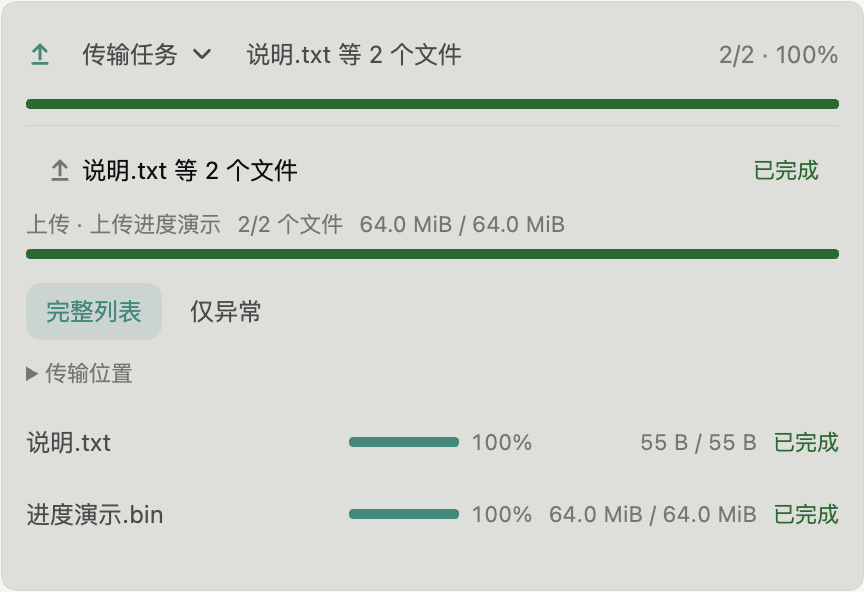
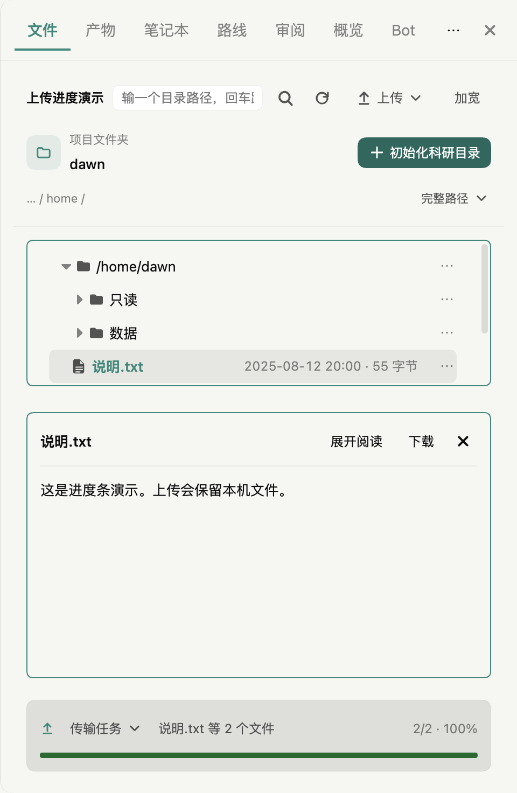
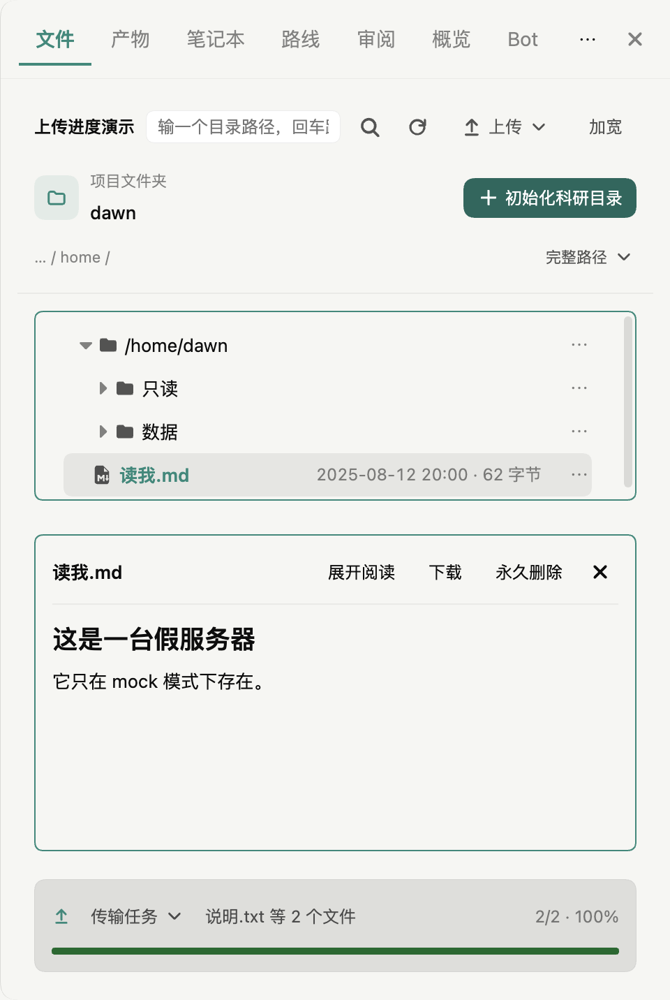

# 上传入口、确认与进度条：分支预览验收

日期：2026-10-21（Asia/Shanghai）。基线：本地main `ac3a4160`。分支：`codex/ssh-upload-experience`。
工作树：`/Users/liuyue/.codex/worktrees/ssh-upload-experience/dawn-science`。

## 用户确认与本轮结果

用户选择「入口、确认和进度一起优化」，随后追加「进度条，可以搞吗？」。本轮沿用原文件面板、主题和Button，未创建独立上传页面。下方预览阶段证据保留；用户确认布局后已追加授权核对、提交并本地合并main，明确不推送。最新集成状态见文末。

- 工具栏使用上传图标+「上传」下拉，包含文件/文件夹；拖入普通文件会先展示目标确认，并提示本机文件保留。文件夹仍用菜单选择，未宣称已支持文件夹拖入。
- 上传确认分行显示选中内容、服务器、目录；来源/长目标路径可展开，内容过长可滚动，使用普通主题色「开始上传」。取消确认不产生任务；连接ID与目标路径在系统选择器打开前捕获，切换前台不会换目标。
- 单文件、多文件和目录上传共用后端任务及底部面板。文件直接进入目标目录，不多套一层文件夹；原startUpload单文件协议仍保留兼容。
- 总体与任务各有进度条；每个文件单行包含细进度条、百分比、字节和状态。总量未知先显示计算状态；零字节只有完成后100%。传输字节达到100%仍须等待提交成功，不能把进度百分比当成功状态。
- 用户指出下方行未对齐后，将各文件独立flex排版改为共享网格列；字节长度不再挤动进度条，百分比/大小/状态各列对齐，数值靠右。目录状态位于相同末列，错误和冲突操作占整行。
- 用户进一步批准目录、文件预览、底部传输的顺序；DOM与普通模式网格同步调整，加宽模式仍左树右预览、传输位于两列底部。展开时底边不动，明细内部滚动，摘要及总进度不滚走；上限为文件面板三分之一，并按工具栏后的可用高度进一步收缩。窄矮窗临时压缩目录以留出预览，不写回偏好，无任务高度为0。
- 完成数仅统计文件；失败、冲突、取消与中断可通过「仅异常」在全量条目中过滤后分页。错误按需展开，未完成项手动重传，覆盖继续二次确认。
- 复用有界并发、源变更检查、part提交、退出收尾和上传记账。不同来源同名文件通过目标预留串行核对，不静默覆盖；没有新增断点续传、自动覆盖或同步删除。

## 验证证据

| 检查 | 实际结果 |
|---|---|
| 基线定向 | 3文件13项通过，`/tmp/dawn-upload-baseline.log` |
| 服务先红后绿 | 缺少startFiles及操作先失败；实现后服务/后端/协议3文件63项通过，`/tmp/dawn-upload-service-red.log`、`/tmp/dawn-upload-protocol-red.log`、`/tmp/dawn-upload-service-green.log` |
| 全量单测 | 449文件4886 passed、10 skipped（4896项），`/tmp/dawn-upload-all.log`；其后的进度条与窄栏小改动另做下行复验 |
| 最终UI/进度条 | 原实现缺少总体progressbar语义的断言先红；最终4文件113项通过，`/tmp/dawn-upload-progress-red.log`、`/tmp/dawn-upload-progress-green.log` |
| 类型与构建 | 通过，`/tmp/dawn-upload-typecheck-final.log`、`/tmp/dawn-upload-build-final.log`；保留已有大分块警告 |
| Electron功能 | 目录往返/失败重试/取消、原单文件上传冲突与记账、拖入反馈、下载/另存共6项通过，`/tmp/dawn-upload-progress-electron.log`；同一轮新增进度用例最初因示例太小只看到100%而失败，见下行修正 |
| 实际中间进度 | 16MiB合成文件配fake写入延迟，明确断言总体百分比在0与100之间，再等待完成；逐文件100%、本机源保留、Unicode与4字节二进制下载比对、隐藏继续、异常筛选及窄栏尺寸通过，`/tmp/dawn-upload-progress-real-final.log`（1/1） |
| 视觉基线 | 固定构建、暂时隐藏旁观预览后默认亮暗14/14通过，`/tmp/dawn-upload-visual-isolated-final.log`；未重存PNG或放宽阈值 |
| 对齐回归 | 实际Electron新增各列左右边缘几何检查，原实现出现54.14px差异，`/tmp/dawn-upload-alignment-red.log`；修复后宽栏/极窄栏/收起左侧栏的明细对齐误差均≤1px，文件与目录状态同列、行高≤36px，3/3通过，`/tmp/dawn-upload-alignment-electron-final.log` |
| 对齐后复验 | UI单测2文件4项、类型检查、UI构建及diff检查通过，`/tmp/dawn-upload-alignment-unit.log`、`/tmp/dawn-upload-alignment-typecheck.log`、`/tmp/dawn-upload-alignment-build.log`；本次仅CSS布局修复，未重复全量单测或视觉基线 |
| 底部布局先红后绿 | 新几何检查先发现预览在传输下方（764px与431px），`/tmp/dawn-upload-footer-red.log`；窄矮窗追加回归再发现24px预览与传输重叠，`/tmp/dawn-upload-footer-short-red.log`；最终上传体验用例通过，`/tmp/dawn-upload-footer-green-final.log` |
| 底部布局最终Electron | 固定构建后11/11通过，`/tmp/dawn-upload-footer-electron-verified.log`；含无任务零高、普通/加宽、关闭预览/展开阅读、窄窗/矮窗、固定底边、三分之一上限、内部滚动、原列对齐、目录往返及内容核对 |
| 底部布局最终检查 | UI/设计契约5文件155项通过，`/tmp/dawn-upload-footer-unit-final.log`；类型检查、UI构建、diff检查通过，`/tmp/dawn-upload-footer-typecheck-final.log`、`/tmp/dawn-upload-footer-build.log`；本轮未重复全量单测及默认视觉基线 |

视觉检查过程中有两种已记录的中断：测试运行时重建UI导致一次ERR_FILE_NOT_FOUND（操作安排失误）；另有命令面板暗色4617像素阴影差异，已查看diff，原main单跑与分支隔离单跑均通过，最后隔离整组14/14通过。原始日志：`/tmp/dawn-upload-electron-final.log`、`/tmp/dawn-upload-visual-final.log`、`/tmp/dawn-upload-main-palette.log`、`/tmp/dawn-upload-palette-isolated.log`。不将中断说成首轮全部通过。

另有上一轮已在原始main独立构建复现的4项旧远端界面用例，本轮组合检查明确排除，详情见 [目录传输验收](2026-10-21-ssh-directory-transfer-verification.md)。不宣称全仓库Electron全绿。

底部布局实现过程中，设计契约曾拒绝CSS变量内联回退值，已改为在容器定义初始值；首轮组合10/11后暴露测试对展开状态的错误假定，修为按aria-expanded操作。随后实际极窄面板揭示展开时零高明细区不可点击，已在收起时就为下一次展开预留一行并通过最终同路径回归。过程日志保留在`/tmp/dawn-upload-footer-unit.log`、`/tmp/dawn-upload-footer-electron-final.log`、`/tmp/dawn-upload-footer-short-green.log`；未放宽断言或以强制点击掩盖遮挡。

## 实际预览与边界

- 最终预览来自本工作树dist，隔离profile：`/var/folders/2t/y0qcl9r50cv427189l7px1000000gn/T/dawn-upload-progress-preview-9243x9`，窗口标题明确标为演示服务器。
- 较大合成文件用于观察持续进度，fake写入延迟只用于演示，不代表真实网络吞吐；没有连接真服务器或传输用户科研数据。
- 默认宽度1380px；文件明细单行28px。900px保留两侧栏时既有整体布局会挤窄右栏，本轮仅使自己的摘要小于90px且无横向溢出；收起左栏查看完整明细。未改整个应用的分栏规则。
- 已查看实际确认框、亮色任务和窄窗暗色截图。实现由本会话自行复核，没有委派子agent或声称独立审查。

上一轮对齐预览中55B与64MiB两行的进度列均从x=1222.3125开始，字节列宽均104.1875px，状态列同为x=1434.5；保留同一批次检查修正结果。

## 底部布局实际预览

同一隔离profile和同一演示批次，已选中说明文件并显示正文，窗口置前供用户验收。常规面板高度656px，展开传输171.38px，预览182.28px；暗色1100×720窄窗面板高度516px，展开传输122.59px、预览108.09px，两次底边差均为0。最终留窗为亮色、传输摘要收起，点击「传输任务」可向上展开。

截图：`artifacts/upload-experience/footer-collapsed-light.png`、`footer-expanded-light.png`、`footer-expanded-dark-narrow.png`、`footer-preview-full.png`。不涉及真实公网SSH或用户数据。

## 合并前最终复核

用户已明确授权本地提交与合并，不授权推送或安装版替换。按仓库路线图自行复核，未委派子agent。核对范围包括选中文件直传、目标身份冻结、同名预留、part提交、上传记账、取消/重试、异常过滤、持久化兼容与底部布局。

发现并修正根目录上传边界：`safeTarget`原先将根目录`/`也拼成`//`前缀，导致合法`/文件名`被误判越界。新回归先报failed，修正后普通文件可上传到fake根目录、内容相同且本机源保留；不绕过真实目标权限、链接或越界检查。日志：`/tmp/dawn-upload-root-red.log`、`/tmp/dawn-upload-root-green.log`（3文件64项通过）。实际Electron上传用例补充同一操作及根目录文件内容核对。

- 全量最终：449个测试文件，4887 passed / 10 skipped（4897项），`/tmp/dawn-upload-premerge-all-final.log`。
- 类型检查及完整构建通过，`/tmp/dawn-upload-premerge-typecheck-final.log`、`/tmp/dawn-upload-premerge-build-final.log`；已有大分块提示保留。
- 固定构建、暂时隐藏旁观预览后，相关Electron与默认亮暗视觉53/53通过，`/tmp/dawn-upload-premerge-electron-verified.log`；包括根目录上传与本机源保留、单文件同名处理/记账、拖入反馈、下载/另存、目录往返、失败/取消/重试及底部布局。未更新PNG或放宽阈值，仅排除已在原始基线证实失败的四项旧界面用例（最窄侧栏菜单、固定入口、下载设置旧可见性、旧预览删除入口）；不宣称全仓库Electron全绿。
- 修正前全量检查因实现更新而中止，两个界面组合因排除表达式核对而主动中止，均不计为通过：`/tmp/dawn-upload-premerge-all.log`、`/tmp/dawn-upload-premerge-electron.log`、`/tmp/dawn-upload-premerge-electron-final.log`。最终结果以完整结束的日志为准。

## 本地main集成结果

2026-10-21按用户授权完成。功能提交`f669d1f84676892606597b718a24c7a7ee789731`（`feat(remote): unify upload confirmation and bottom transfer progress`），主工作区干净时从`ac3a4160`执行`git merge --ff-only codex/ssh-upload-experience`，成功快进，无冲突。

- main完整重建通过：`/tmp/dawn-upload-main-build.log`。
- main关键服务、后端、协议及UI测试5文件68项通过：`/tmp/dawn-upload-main-tests.log`。
- main的实际dist再次执行目录往返、失败/取消/重试及统一上传/进度/根目录/布局验收，3/3通过：`/tmp/dawn-upload-main-electron.log`。
- 预览已重启为主工作区main构建，启动入口`/var/folders/2t/y0qcl9r50cv427189l7px1000000gn/T/dawn-upload-progress-preview-9243x9/main-entry.mjs`；页面URL确认来自`/Users/liuyue/Desktop/Github_repos/dawn-science/dist/ui/index.html`。保留原隔离数据库与用户已在演示预览中产生的会话，未改写会话内容；重连演示服务器，选中其自带的读我文件，实测底部传输边缘与面板底边一致。
- mock服务器内存中的演示文件不跨进程持久化，已完成任务历史保留；main预览使用自带读我文件展示布局，明确不把fake对端当真实服务器。主路径用例独立核对了实际上传内容与本机源保留。
- 截图`artifacts/upload-experience/main-footer-preview.png`已查看；重启后的首次隐藏窗口截图未稳定，显示窗口后采集成功，未更新视觉基线。
- 未执行push、远程合并、tag或安装版替换；`origin/main`本地引用仍为`b537c8e554f2962863e479932799572c4c79676b`。功能分支和工作树保留。

