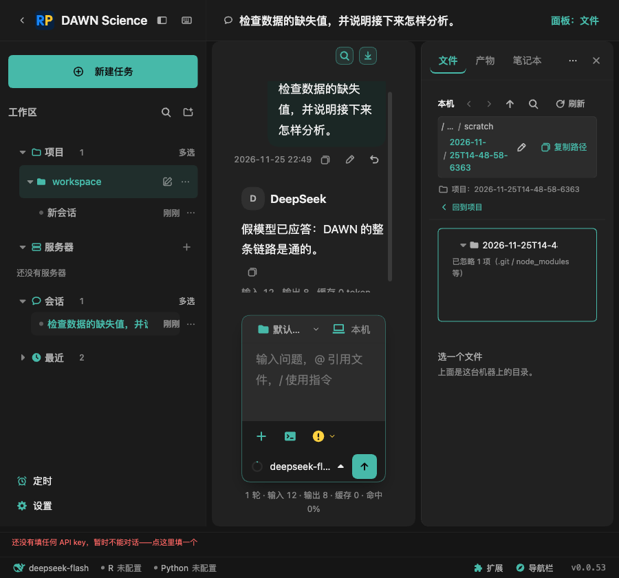
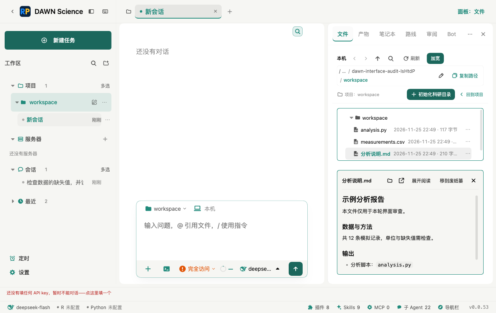

# 对话、坞与主要页面：界面审查和设计草案

日期：2026-11-25（Asia/Shanghai）

分支：`codex/workbench-interface-design-20261125`

基线：`b6ae62a08f87b89bfcdd0b5bf508ad275b0bb6bb`，v0.0.53

状态：**供用户审阅的设计草案；尚未确认设计、尚未修改产品代码。**

## 1. 判断

需要继续优化，优先处理空间分配、入口组织和内容层次。现有浅底、青绿色强调、小圆角、三栏布局已经形成稳定风格，建议沿用。

最有价值的第一轮是：缩窄对话内边距、压低空闲输入区、补齐坞标签键盘交互。第二轮再调整坞入口组织；文件阅读和协作台分别进行专项设计。首页和项目创建流程维持既有方向，仅做局部一致性优化。

这是设计判断，不是已经证明的用户效率提升。下文区分实际观察、源码核对与待验收建议。

## 2. 本次实际查看了什么

从当前分支重新执行 `npm run build`，在 macOS Electron 中启动私有配置、数据库、工作区和 user-data；模型仅连接本机共享 mock。未连接真实模型、远端服务器或正式 App 数据。

截图中的未配置 API key/内核提示来自本轮隔离配置，不能据此判定正式 App 配置异常。样例报告仅为排版内容，其数字不代表已计算的数据结果。

- 首页、新对话入口、一次假模型往返、主对话和输入区。
- 坞内全部 11 类面板：文件、产物、笔记本、路线、审阅、概览、网页、子 agent、团队、对话、Bot。后十项主要查看空态或轻量 mock 状态。
- 项目文件树和 Markdown 预览；样例文件仅服务界面审查，没有执行科学分析。
- 设置分类栏、完整外观页、浅色与深色切换、返回工作台。
- 定时任务空页；未创建或运行定时任务。
- 900、1440、1920 CSS px 窗口宽度，840px 窗口高度；方向键操作坞标签。

另核对 `docs/DESIGN.md`、现有响应式布局验收文档，以及 `views.tsx`、`dock-tabs.ts`、`workbench-layout.ts`、`styles.css`、`tokens.css`、`artifacts.tsx`、`settings-column.tsx` 和 `turn-process.ts`。

证据位于 [界面截图与记录](../../output/playwright/interface-design-20261125/)。尺寸数据见 [layout-measurements.json](../../output/playwright/interface-design-20261125/layout-measurements.json)，各面板文案见 [panel-inventory.json](../../output/playwright/interface-design-20261125/panel-inventory.json)。

未覆盖：真实长对话、执行中的多成员协作、活动内核、文件传输和大批量产物；英文长文案、物理跨屏/DPI、Windows/Linux 真机。没有运行全量回归或逐像素基线比较。本次构建成功，仍有 direct-eval 和大 chunk 提示。

## 3. 对话界面

### 已观察到的空间问题（P1）

左右栏展开时，测得如下尺寸；正文宽度为 `.turns-inner`，输入卡为 `.composer-card`：

| 窗口宽度 | 主区宽度 | 正文/输入卡宽度 | 输入卡高度 | 主区高度 |
|---:|---:|---:|---:|---:|
| 900 | 296 | 210 | 243.25 | 704.95 |
| 1440 | 636 | 550 | 199.25 | 704.95 |
| 1920 | 856 | 770 | 199.25 | 704.95 |

900px 时，正文左右合计留出 86px，约占主区宽度的 29%；空闲输入卡约占主区高度的 35%。三种尺寸均没有文档级横向溢出，但窄栏文字和模型控件明显更拥挤。实际图像比单纯的 `scrollWidth` 通过更能说明问题。



源码中 `.turns` 和主对话 `.composer` 的横向间距，以及固定输入字段高度，是这一轮应共同审视的入口。已有响应式外栏比例逻辑保留；不能把此前已实现的窗口适配再次当作缺失功能。

### 建议设计

1. **以对话容器宽度决定留白。** 主区低于 420px 时进入紧凑布局，正文与输入卡继续对齐；296px 主区的有效正文宽度目标至少 256px，滚动条预留计入预算。宽栏保持舒适的阅读宽度上限，不通过放大所有控件填满屏幕。
2. **输入区随内容增长。** 普通空闲状态默认两行左右，输入后增长到六行或可用主区高度的 35%（取更小值），之后在输入区内滚动。窄栏空闲输入卡目标不超过 180px；附件、澄清问答和方案审批属于另行验收的内容状态，不机械套用空闲上限。
3. **发送、停止、权限持续可达。** 发送按钮保留现有 36px 实测尺寸。长模型名可省略并提供完整提示；权限仍可辨认和点击，不能仅靠颜色判断。输入法组合、草稿、附件和快捷键行为保持。
4. **用量分主次。** 每轮用量与整段会话用量保留真实口径；默认采用一行紧凑摘要，详细输入/输出/缓存与压缩说明按需展开。不要把几个来源不一致的数相加为新合计。

### 阅读层次的专项建议（P2，尚未在长任务中验收）

已有完成过程分组和“简洁/标准”偏好，直接复用。保持“用户问题 → 当前工作摘要 → 回复正文 → 相关文件”的视觉顺序：正在执行的步骤和等待确认可见，已完成过程沿用户偏好收纳，错误保留提示和展开入口。最终回复、问题、方案和重要风险不能被折叠进工具过程。

原始工具、完整脚本和细节继续能查；不新增一个需要模型重复生成的“结果摘要”来源。

## 4. 坞入口

### 已观察到的问题（P1/P2）

- `全部房客` 已有 11 类。当前算法按可用宽度决定显示哪些标签，并保证当前项可见；这是已有能力。
- 本次在文件面板下，900px 显示 3 个标签，1440px 显示 7 个，1920px 显示 9 个。宽度或当前面板改变后，显露的其他标签也会改变；“更多”中是平铺列表。
- “审阅”实际包含 Git 变更与工具账本，初看容易被理解为科研结论审查；“概览”集中的是成本、上下文和环境。“团队 / 子 agent / Bot / 对话”也需要额外解释其关系。
- 标签有 `role=tab`。实测文件标签聚焦后按 `ArrowRight`，焦点与选中项仍为文件；当时 7 个可见标签均为 `tabIndex=0`。更多菜单已有上下键和 Escape 行为，不能笼统称其没有键盘支持。

### 建议设计：稳定入口 + 分组更多

常用的 **文件、产物、笔记本** 保留固定顺序；再显示当前面板（如果它不在常用三项中），最后是“更多”和关闭。可用空间不足时仍由实际测量算法收回非当前项，当前项必须可见。

宽屏不再逐个摊开全部高级入口。对于 480px 及以上的标准坞，目标是同一套入口位置；对 280px 窄坞，不承诺强行塞下四个标签。

“更多”只列未显示的项，按用途分组；空组不显示：

| 分组 | 原有面板 | 补充说明 |
|---|---|---|
| 工作过程 | 路线、审阅、概览 | 分析步骤；文件变更与执行记录；用量与环境 |
| 协作与对话 | 子 agent、团队、Bot、对话 | 本轮子任务；分工与执行；可复用助手；独立侧边对话 |
| 浏览 | 网页 | 自己浏览或旁观 agent 浏览器 |

这些是菜单组织和说明，不合并后端能力、不改变 tenant ID。第一轮保留原标签文字；“对话”是否改为“侧边对话”、“审阅”是否改为“变更”留在确认项中，避免一次改动引发过多术语变化。

键盘采用单一 tab 停靠点；左右键切换焦点，Home/End 定位首尾，Enter/Space 激活。采用手动激活，避免方向键浏览就切换工作内容。切面板或调宽后若原焦点仍然有效，不主动移动；关闭返回触发按钮。

示意（设计草案，并非已实现界面）：

```text
文件   产物   笔记本   [当前其他面板]   更多 ⋯   ×
──────────────────────────────────────────
面板自身标题 / 当前项目或会话 / 必要操作
──────────────────────────────────────────
内容工作区
```

## 5. 文件与产物

### 文件阅读（P2）

现状已经具备上级、前进/后退、地址编辑、复制路径、回到项目、跨目录浏览和展开阅读，应复用。



窄坞中，导航工具、路径、项目提示、文件树、预览工具栏逐层占高。建议：

- 导航工具和路径保持一组紧凑位置；长路径中间省略，末级目录优先完整可辨，展开/编辑时可取到完整路径。避免时间戳目录在多行反复折断。
- 当前目录就是项目根时，以轻量项目标记说明，减少重复展示；“初始化科研目录”收进有文字的操作菜单，空项目时保留清晰引导。
- 树与预览之间的主题色描边弱化为中性分隔，选中行和聚焦态保留强调色。普通工具采用次级外观，让正文标题和内容成为主视觉。
- 继续使用既有 560px 双栏条件和展开阅读机制。窄栏展开阅读时可手动暂收文件树；返回恢复文件、树位置和预览滚动。传输仍归文件面板底部。
- 删除/废纸篓收进文件操作菜单并保留文字与危险语义；预览工具栏优先展示打开、展开/还原、关闭。该变动单独验收可发现性，不能把功能变成只能悬停出现。

### 产物（P2，内容丰富状态待查）

现有“结果 / 历史 / 更多”、预览、留存与整理交付能力保留，不再造一套产物数据库。

建议在原列表中清楚区分文件名、类型/来源、原有核验状态和下一步操作，主要动作保持“预览 / 打开 / 整理交付”。生成、保留和通过核验是不同事实，不能用一个绿色勾代替。尚无核验结论时明确显示未核验；历史版本继续显式标识。

## 6. 协作、笔记本与其他页面

| 页面 | 本轮观察或核对 | 建议与优先级 |
|---|---|---|
| 团队 | 空协作状态首屏先显示自动安排说明、约束和两个输入框，任务结果/执行记录位于后续区域 | P2：默认先呈现当前状态、成员/任务和下一步；“安排任务”按需展开。未发生执行时不制造失败或已通过的印象 |
| 子 agent / Bot / 侧边对话 | 入口分立，空态说明的详细程度不同 | P2：统一空态结构为用途、当前状态、一个明确下一步。三个工作流保留各自边界，侧边对话标识其独立会话属性 |
| 笔记本 | 未连接内核时仍显示 Python/R、运行区和“变量”入口 | P2：把未连接状态、选择内核和运行按钮的关系说清。无内核时给出真实的禁用原因；不为预览自动启动内核 |
| 审阅 | 非 Git 工作区显示无法确定基线，仍提供账本信息 | P2：首屏说明“文件变更与执行记录”；保留“不确定”的事实，不把非 Git 当作科研任务失败 |
| 概览 | 成本、上下文、环境、历史、附件同处一页 | P3：以用量/环境分节，字节与 token 分开。保留路径和完整诊断入口 |
| 网页 | 自己浏览和 agent 旁观已有双模式 | P3：加强来源/模式标题和连接状态一致性，保留本来导航规则 |
| 设置 | 侧栏列表和完整外观页均可使用，分类约 15 项；外观首屏含多组颜色控件 | P3：分类检索和基础/高级外观分层。继续共用同一 sections 数据；语言、主题、字号先显示，自定义背景按需展开 |
| 首页 | 舒展双栏、项目卡、最近会话已经落地 | P3：补项目/会话多和长路径时的密度审查；不重新改变四步引导 → 首页 → 工作台顺序 |
| 项目创建 | 本轮只核对既有实现与契约，未新建真实项目 | P3：后续单独复核长路径、重复目录、取消返回。复用既有弹窗 |
| 定时 | 空页已说明关 App 不执行、超时跳过和无人值守权限限制 | P3：保留这些条件，压缩首屏说明并突出创建入口；配置后状态和执行记录需另验 |
| 底部状态栏 | 同时显示模型、内核、扩展数量；窄窗已能收纳扩展 | P3：保持轻量摘要，可操作项聚焦可见；详细环境和扩展信息留在既有入口 |
| 终端 | 本轮没有实际启动，只核对与右侧坞分开的现有约定 | 独立专项：保留主区完整终端、退出返回和原草稿；不要塞进右侧坞 |

## 7. 三种方案比较

| 方案 | 内容 | 收益与代价 |
|---|---|---|
| A：局部修整 | 仅窄栏留白、输入高度和键盘交互 | 变更集中、可快速验收；坞和协作台的信息组织仍维持现状 |
| **B：保留风格，按任务整理层次（推荐）** | A + 稳定坞入口/分组菜单 + 文件阅读与协作首屏专项 | 能改善主要工作动线；需要逐轮验收入口可发现性和状态恢复 |
| C：全面换版 | 重组导航、主题、组件及页面 | 范围大、回归面广；本次观察尚不足以支持这样的投入 |

推荐 B，但按 A → 坞导航 → 文件阅读 → 协作台依次落地，各阶段独立确认。颜色、图标和装饰只在确实影响层次时局部调整。

## 8. 实现边界与验收设计

本次只形成审查和草案。确认后另建正式 spec 和实施计划；需要确认的是方案力度，以及首轮是否采用“窄栏对话 + 输入区 + 键盘操作”。

实现优先复用：`Button`、Tooltip、现有菜单与错误组件；`RightDock` / `useDockTabs` / `fitDockTabs`；`ConversationView`、现有过程分组；文件导航与预览组件；`SettingsColumn` 的共享 sections；现有窗口比例状态。新增几何令牌必须登记到 `tokens.css` 并遵守 `docs/DESIGN.md`。

不新增模型调用或执行协议，不为界面整理修改科研产物核验规则。已有会话、文件和工作面板状态沿原作用域保存；不新增一个含糊的全局布局偏好。

| 验收范围 | 必须验证的行为 |
|---|---|
| 窄对话 | 900/1280/1440/1920/2560px，侧栏开/关、坞开/关；正文/输入卡对齐；900px 三栏有效内容宽度目标 ≥256px，普通空闲输入卡高度 ≤180px |
| 输入 | 发送/停止、模型与权限可达；中文输入法、长草稿、附件、澄清问答、排队/调整方向和失败恢复不受损 |
| 导航 | 当前面板可见；不同宽度下入口顺序稳定；更多只列隐藏项；无数据时仍能找到并理解入口 |
| 键盘 | tab 单停靠点、左右/Home/End 移焦、Enter/Space 激活；菜单上下/Escape、关闭回焦，不抢正文输入焦点 |
| 文件阅读 | 当前目录、预览和滚动在切面板/展开/还原后恢复；长路径可复制，来源明确；传输/危险操作仍可达 |
| 协作 | 空态、运行、待确认、失败/取消、完成且未核验、核验通过均分别显示；详细过程和旧执行记录可访问 |
| 视觉 | 中文/英文，明暗主题，字号最小/默认/最大；逐张检查实际图与 diff 后才决定是否更新基线，不放宽阈值掩盖问题 |

首轮实现后运行相关 Node/UI、类型检查和真实 Electron 用例。仅文档设计不需要重跑全量测试；本次构建和人工交互不能作为未来改版的验收结果。

## 9. 本次收尾

隔离 Electron 和本地 mock 服务器已关闭，本轮登记的临时运行根已删除。截图、尺寸和面板记录保存在分支内；产品源码未改，未更新视觉基线。未合并 main、未推送、未发布或替换正式安装版。
