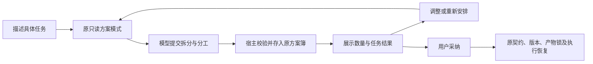

# 默认自动安排实施计划

> **For agentic workers:** 使用 superpowers:executing-plans 单线实施；先写反例再修改。用户已确认默认自动安排和方案结果可调整。复用已有专项工作区，不自动提交或合并。

**Goal:** 用户只描述具体任务；DAWN 根据任务与可读取的数据提出可调整的拆分、分工和依赖，任务块数由方案推导，不再让用户预填数字。

**Architecture:** 复用既有先出方案、只读工具门、propose_plan、方案簿、审批/编辑/存档/恢复和会话发送链路。模型提交可选结构化 arrangement，宿主校验并转为可读的规范 Markdown 任务安排节；方案仍以原 markdown 为唯一持久事实，不增加调度器、数据库表或第二份规划状态。UI 只解析宿主规范节显示任务卡和数量，不用关键词或固定模板决定如何拆任务。

**Tech Stack:** TypeScript、Zod/TypeBox、React、nanostores、Vitest、Playwright/Electron；无新依赖，无新 IPC 操作。

## 当前状态与本轮边界

- 基线 main d0b6ca78；继续 codex/mode-member-workspace-20261108 的现有未提交改动。
- 上一轮手工任务块表单是已验证历史方案；本轮明确替代其交互，不将原截图和报告改成自动安排成果。
- 修改前源码、测试及文档快照在 /tmp/dawn-auto-arrange-20261108/before/，SHA 在 before-sha256.json。正式 App、配置、凭证、数据库不操作。
- 本轮只运行 localhost 确定性推理夹具，不新增付费 API 调用；用户未来主动生成安排使用其会话原模型和预算。
- 原统一成员入口、会话隔离、执行代次、取消排空、产物版本/锁及恢复保持；不推送、不发布，不自动提交/合并。
- 历史偶发 7350/20690ms OS 退出和长期 Bot/MCP stopping 继续 OPEN，1500/4000ms 预算不变。

## 用户流程

1. 打开协作台，默认看到「自动安排」。直接描述任务，或从所属会话当前草稿带入；不出现任务块数字输入。
2. 点击「生成安排」后，先开启原只读方案模式，再通过原发送链交给当前模型。运行中/不支持的运行时说明原因，不将规划请求偷偷排入正在执行的任务。
3. 模型根据问题、输入文件、输出目标、依赖及独立审阅要求决定粒度。小任务可以只有一块；不够信息时提出待确认项，不套固定三块模板。
4. propose_plan 提交方案和结构化 arrangement。宿主验证 ID、依赖环、共用输出冲突、角色及独立审阅，转换为可读 Markdown。界面显示任务数、方式、每块目标/分工/输入/输出/依赖/验收以及待确认项；显示“方案建议”，不冒充已运行 Agent 或冻结执行契约。
5. 原方案卡「改一改」允许修改可读任务节；解析与数量跟随修改，非法依赖/删除审阅等在采纳前指出并拒绝。用户也可用调整要求重新生成，旧版按既有方案簿 superseded。
6. 「照这个做」仍走原 answerPlan→保存/指纹→退出方案模式→执行；取消、不采用和重启仍走既有路径。

## 方案取舍

选择复用模型先出方案及单份 Markdown 存储，避免复刻执行器。没有采用本地关键词猜任务数，也没有添加独立模型请求通道或另存一份可与方案正文漂移的任务 JSON。解析只负责展示和校验规范节；任务拆解由实际会话模型产生。

## A 任务方案契约与工具（先测试）

**Files:** 新增 src/protocol/task-arrangement.ts、tests/protocol/task-arrangement.test.ts；修改 src/tools/propose-plan.ts、tests/tools/propose-plan.test.ts、src/runtime/native.ts。

- [x] 用有效一块任务、多个独立块、串行依赖与独立审阅写 schema/序列化往返测试；先运行观察缺少模块红灯。
- [x] TaskArrangement 字段：mode(single/parallel/chain/science)、rationale、independentReview、tasks(1–12)、questions；每块 id/title/goal/role/inputs/outputs/dependencies/acceptance/review。数量只取 tasks.length。
- [x] 校验重复 ID、未知/重复依赖、依赖环、空任务、非法路径、并行共用写入/前后依赖，以及要求审阅时必须有与执行角色分离的 review 块。不把规划角色当已冻结执行者。
- [x] serializeTaskArrangement 生成规范可读「## 任务安排（自动安排）」节；parseTaskArrangement 从该节恢复同一结构。字段一行一条，数组逐条列，所有输入有长度与换行约束；格式错误返回可见问题，不静默沿用旧数量。
- [x] propose_plan 新增可选 arrangement 参数，严格校验后生成任务节，再沿原交回调存 markdown；旧五节方案与旧参数完全兼容。工具指引明确根据任务决定数量/分工，不能为了凑数拆任务。
- [x] Native answerPlan 对含规范节的编辑正文重新校验；原 independentReview 要求不能通过去掉任务节或改字段静默降级。旧非任务安排方案继续按原编辑审批。
- [x] 运行 `npx vitest run tests/protocol/task-arrangement.test.ts tests/tools/propose-plan.test.ts tests/runtime/plan-book.test.ts tests/runtime/plan-mode.test.ts`，保存红/绿日志。

## B 自动安排入口和可调整结果

**Files:** 修改 src/ui/orchestration-advisor.tsx、src/ui/run-overview.tsx、src/ui/team-panel.tsx、src/ui/App.tsx；新增 src/ui/task-arrangement-view.tsx 与 tests/ui/task-arrangement-view.test.tsx；修改 tests/ui/orchestration-advisor.test.tsx、src/ui/plan-card.tsx、src/ui/i18n/en.ts、src/ui/styles.css。

- [x] 新界面反例：首次无 number 输入、可描述任务、空任务不发送；按一次生成只调用一次；读取 owner 草稿，所属会话改变后不误发。
- [x] 替换旧数字/关系表单，默认「自动安排」，提供任务目标、可选调整要求、生成按钮、状态/错误与结果入口；旧 mode-advice 纯规则与历史评测保留用于已知结构检查，不参与任务语义拆解。
- [x] 从精确所属主/侧槽取得最新方案（原 planId/version/status/markdown），不借另一会话方案。任务数量来自解析后的数组，不能写死 3。
- [x] App 生成 callback 复用取写权、dawn.plan 和原对话发送。前后检查 owner/会话/请求代次，运行中拒绝、失败保留任务文本，不发送到新会话；不支持的运行时禁用并说明。
- [x] 方案卡和协作台共用 TaskArrangementView：任务数、模式、理由、任务卡、依赖和待确认。原文修改继续使用原方案卡，采纳前重算并验结构；旧方案卡没有安排节时不显示伪造任务数。
- [x] 检查中英文与设计契约，消除只供旧表单使用的英文孤儿键，保留仍被旧评测使用的文案。
- [x] 运行 `npx vitest run tests/ui/orchestration-advisor.test.tsx tests/ui/task-arrangement-view.test.tsx tests/ui/plan-card.test.tsx tests/ui/i18n.test.ts tests/ui/design-contract.test.ts`。

## C 真实软件链路与效果

**Files:** 新增 scripts/mock-auto-arrangement.mjs（由共享 mock server scenario 接入），e2e/auto-arrangement.spec.ts；调整上一轮 e2e/mode-member-workspace.spec.ts 与 side-session.spec.ts 的已被替代数字输入断言；新增 tests/evaluation/auto-arrangement.test.ts，复用 evaluate:science 子命令记录软件覆盖。

- [x] 确定性夹具根据精确测试任务返回不同的模型工具参数（只用于测试，不是产品语义判断）：简单均值 1 块；两份独立数据 2 块；清洗→建模→独立审阅 3 块；自然语言合并前两步后 2 块。
- [x] Electron 走真实 setSessionConfigOption→send→Pi→propose_plan→方案簿→UI，验证任务数由各个不同返回决定；生成阶段不能写科研文件或派子 Agent。
- [x] 修改方案/重新安排、审批归档、取消生成、重启恢复，以及主侧会话隔离/迟到回复分别验证；错误格式不展示成有效安排。
- [x] 保存 stage-a-auto-default.png、stage-b-task-1/2/3.png、stage-b-adjusted.png、stage-c-restored.png；查看真实图片后向用户展示，不生成假界面。
- [x] 运行现有相关 plan-mode、collaboration-network、subagent-steering-epoch、Bot 只读入口回归，按触及边界选用例，不把新功能测试说成全部桌面验收。

## D 审查与收口

- [x] 逐项复审：默认不问数字、语义拆分来自模型、结果调整数量更新、host 验证独立审阅与依赖；非任务安排旧方案继续可编辑审批；正文与数量单一来源。
- [x] 审查 owner/planId/version、运行中/取消/迟到响应，新增入口不绕过租约、方案门、契约、锁与恢复；发现问题先补反例再修复。
- [x] `npm run typecheck`、完整 Node/UI、`npm run build` 及定向 Electron。若触及内核运行则串行补内核，否则说明未改内核范围。
- [x] 更新使用说明、开发历史、长期路线专项台账及本轮验证 README；保留上一轮手动表单的原始报告和截图。
- [x] 记录 source 哈希与退出诊断，main 状态复核；没有未修复阻塞且实图已展示后完成 /goal。保留隔离未提交代码，不自动合并、不推送、不发布。

## 验收判据

- 用户无需先回答“拆几块”；三种不同任务产生不同数量及不同依赖方案，变化可解释。
- “把前两步合并，独立审阅保留”可生成新版，数量随结果变化，旧版可追踪。
- 方案错误/被取消/被替代/其他会话/重启历史均不显示成正在执行的安排。
- 软件验证与真实模型收益分开报告；本轮没有新增付费模型对照。

## 实施细化

- 新增 auto-arrangement-request.ts（请求代次/取消与只读发送复用）和 state/auto-arrangement.ts（从原转录槽派生最新方案/回合完成标记），没有新增会话执行事实。
- 结果生成后置于表单之前，调整要求折叠；若模型结束本轮而没有新有效安排，显示失败原因入口。
- 自动请求 requireArrangement 动态检查当前分支的用户请求，不允许丢失结构后退成普通方案；错误的编辑正文以 invalid_request 返回。
- 规划角色仅为提议，实际执行者、版本和验收继续由既有契约确定。
- 取消复验复现外部入口漏清“等待首字”：宿主确认取消后，用原转录槽的会话作用域及准确 inputId 清理界面等待；不新增持久执行状态。槽切换即清空，后续 inputId 不匹配则不影响新请求。停止前读状态、停止后的反馈均再次核对 owner/窗口代次/inputId；撤回排队消息仍交原输入框恢复路径。

## 最终状态

实施、源码自审与真实 Electron 阶段展示完成，待用户验收。最终 Node/UI 6863 通过/10 跳过、22 相关桌面、类型/构建及 4 项离线评测通过。main 干净且不变，专项未提交/合并，不推送/发布；历史超时 OPEN。详见本轮验证索引。
