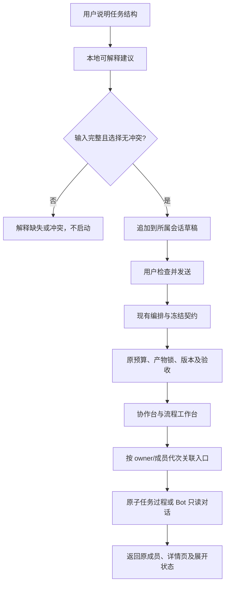

# 编排选择与成员协作入口实施计划

> **For agentic workers:** 使用 superpowers:executing-plans 在本会话逐任务执行。路线图要求只有用户明确委派时才使用子 agent；本轮单线实施和代码复审。步骤用复选框追踪。

**Goal:** 让用户知道何时拆任务、怎样安排执行，并能从协作台可靠地查看、干预成员后回到原位置。

**Architecture:** 增加纯函数规划建议和只读成员身份投影；通过既有会话草稿、子转录控制、Bot 只读会话和窗口视图状态连接界面。没有第二套调度/契约/版本/锁/恢复状态机，无新增第三方依赖。

**Tech Stack:** TypeScript、React、nanostores、Vitest、Playwright/Electron；复用 evaluate:science。

---

## 0. 工作范围与完成定义

- 基线：本地 main `d0b6ca78`；版本仍为 0.0.44，功能尚未发布。
- 分支：`codex/mode-member-workspace-20261108`。
- 工作区：`/Users/liuyue/.codex/worktrees/dawn-mode-member-workspace-20261108/dawn-science`。
- 规格：[编排选择与成员协作入口](../specs/2026-11-08-mode-member-workspace-design.md)。
- 所有命令在专项工作区执行；日志与截图放 `docs/validation/mode-member-workspace-20261108/`。
- 用户体验：先在团队/协作入口展开“如何安排任务”，填结构→看建议和理由→手选或采纳→追加到所属会话草稿→自己发送；已有运行不受建议改变。
- 成员体验：卡片→详情里的统一成员入口→原有过程/对话和允许的控制→返回原协作位置。旧“过程/交接/产物/记录”和“团队管理与原始记录”入口都保留。
- 不改源任务执行、预算公式、产物占用时机、验收逻辑、恢复策略。不修改正式安装 App/config/凭证/数据库。
- 不自动提交、合并、推送或发布。旧 30 次额度已关闭，本轮离线与 localhost 验证，不作真实付费模型收益宣称。

## 1. 分阶段交付表

| 阶段 | 可见变化 | 复用点 | 阶段门与展示 |
|---|---|---|---|
| A 规划建议 | 小任务默认单独做；独立块推荐并行；依赖/共用输出提示串行；独立审阅用科研流水线 | single/parallel/chain、science pipeline、review reserve、会话草稿 | 规则矩阵 + UI + 实际 Electron 草稿截图 |
| B 成员入口 | 查看角色、任务、消息/过程与可用动作；不再只显示技术 ID | RunOverview、TeamSnapshot、SubagentDock、Bot 成员只读面 | 身份/代次/消息测试 + 真实成员跳转与返回截图 |
| C 回归收口 | 切会话不串、展开不丢返回点、取消状态如实展示；原入口可达 | 现有 epoch/inspect/receipts、视图状态、退出诊断 | 完整 Node/UI、typecheck、build、定向桌面、代码审查和风险表 |

## 执行与查看流程



新增的是 B–E 与 J–L 的连接；G–H 沿用现有执行机制。

## 2. 代码职责

| 文件（相对本工作区） | 职责 |
|---|---|
| `src/orchestration/mode-advice.ts`（新） | 纯函数结构校验/推荐/手动选择约束；数据结构不含执行句柄 |
| `src/ui/orchestration-advisor.tsx`（新） | 结构化输入、建议解释、有效选择和追加草稿反馈 |
| `src/ui/orchestration-advice-copy.ts`（新） | 本地化标签、理由及任务草稿说明 |
| `src/evaluation/mode-advice.ts`（新） | 固定代表性规划矩阵与报告，无外部服务 |
| `scripts/evaluate-science-pipeline.ts` | 接入 `--mode-advice <outputDir>`，原分支行为保持 |
| `src/ui/collaboration-member.ts`（新） | 精确成员匹配、角色/任务、普通子转录地址与只读降级 |
| `src/ui/collaboration-member-panel.tsx`（新） | 共用成员展示和入口；本身不发送/停止/恢复任务 |
| `src/ui/state/collaboration-return.ts`（新） | 窗口内返回来源、一次消费、跨会话拒绝 |
| `src/ui/run-overview.tsx` | 接入建议及成员区域，打开前收起 modal，并保留选择/详情 |
| `src/ui/team-panel.tsx` | 传递所属会话草稿和 Bot 打开回调；旧界面保持 |
| `src/ui/App.tsx` | 复用现有 setDraft、看子agent、openBotMember/readOnlyBotCallbacks；子任务返回协作 |
| `src/ui/styles.css`、`src/ui/i18n/en.ts` | 沿用令牌与 primitives；同步完整英文 UI 文案 |

新增文件/导出名以以下任务的定义为准，若实际接线要求调整则先更新此计划，记录原因，不扩展到其他模块。

## 3. 阶段 A：任务颗粒与模式建议

### A1 基线与规则

- [x] 运行相关现有 UI/编排基线并保存输出：`npx vitest run tests/ui/run-overview.test.tsx tests/ui/collaboration-workbench.test.tsx tests/ui/subagent-pane.test.tsx tests/orchestration/run-overview.test.ts`。预期退出 0；基线失败先定位，不假定本轮造成。
- [x] 先创建 `tests/orchestration/mode-advice.test.ts`，运行观察缺少模块的红灯。定义 `adviseMode({blocks,dependency,sharedWrites,independentReview,preferred?})`；blocks 为 1–8 整数或未说明，dependency 为 independent/sequential/unknown。
- [x] 实现 `Mode = single | parallel | chain | science`；返回 recommended、selected、reasons（稳定枚举列表）、reviewRequired、valid。
- [x] 规则按安全优先：独立审阅→science；结构未知→信息不足；单块→single；有依赖/共用写入→chain；多个独立块→parallel。审阅要求不因 preferred 降级；共用写入/依赖不接受强制 parallel；用户明确选择 single/chain 可保留。
- [x] 回归覆盖：小任务、2/8 个独立块、共享输出、依赖、未知关系、无块数、非法块数、显式 single、冲突 parallel、审阅时 single/parallel、审阅 science。例：

```ts
expect(adviseMode({blocks:3,dependency:'independent',sharedWrites:false,independentReview:false}).recommended).toBe('parallel')
expect(adviseMode({blocks:3,dependency:'sequential',sharedWrites:false,independentReview:false,preferred:'parallel'}).valid).toBe(false)
expect(adviseMode({blocks:1,dependency:'independent',sharedWrites:false,independentReview:true,preferred:'single'}).reviewRequired).toBe(true)
```

- [x] 执行 `npx vitest run tests/orchestration/mode-advice.test.ts`，预期全部通过。

### A2 用户可见建议和草稿

- [x] 先写 `tests/ui/orchestration-advisor.test.tsx`：未填写不生成草稿；手选和要求冲突时解释且不应用；填写三块独立任务显示并行理由；应用只调用一次草稿回调，无网络；修改输入后清除过期应用反馈。
- [x] 新增 `OrchestrationAdvisor`：以 `<details>` 保持协作主界面简洁。结构表单显示任务块数、依赖、共用输出、独立审阅和手选模式；显示建议/理由/警示。
- [x] 新增 `modeLabel`/`adviceReason`/`adviceDraft` 本地化函数；草稿包含用户结构、选用模式、独立审阅不可省略、复用现有契约与产物版本、只做建议而非强制切换说明。
- [x] RunOverview 只在有效 owner 下展示，按 owner 重置表单。App 追加到 owner 的原草稿，不覆盖已有文字，不发送；主/侧会话分别检查可见归属。
- [x] 英文键、设计契约一起验：`npx vitest run tests/ui/orchestration-advisor.test.tsx tests/ui/i18n.test.ts tests/ui/design-contract.test.ts`。

### A3 规划评测与阶段展示

- [x] 新增矩阵测试 `tests/evaluation/mode-advice.test.ts`，要求有任务类别、输入、预期推荐、实际推荐、手选有效性、审阅保留和限制声明；失败使命令非零退出。
- [x] 将纯评测报告接入原入口 `npx tsx scripts/evaluate-science-pipeline.ts --mode-advice docs/validation/mode-member-workspace-20261108/evaluation`，不会触发原完整 science 测试或读取凭证。
- [x] 新增 `e2e/mode-member-workspace.spec.ts` 第一个用例：协作入口填写→采纳→主输入区出现追加草稿→没有自动发送；切到另一个会话不带表单或草稿。
- [x] 构建后跑这个桌面用例，截图保存 stage-a-advice.png/stage-a-draft.png；向用户展示实图及规则矩阵结果。不报告节省模型请求数或质量提升。

## 4. 阶段 B：统一成员入口与返回

### B1 精确身份投影

- [x] 创建 `tests/ui/collaboration-member.test.ts` 红灯。`collaborationMember(snapshot,run,owner)` 首先要求 snapshot.ownerSessionId===owner 且 run 来自该快照；普通子任务仅接受两个地址字段及安全整数 index。
- [x] 团队/Bot 成员必须匹配所属 team.id、captainSessionId、run.address 三段及 member.orchestrationId 或 joinedAt 代次；已移除或同名新 incarnation 不关联。Bot 的 botId 必须来自精确匹配的当前成员。
- [x] 普通子任务返回 transcript 目标；团队返回角色、当前 taskAttempt 对应任务及当前快照邮箱；Bot 返回只读成员目标。未知记录显示 unavailable，而不猜 session ID、消息或控制能力。
- [x] 测试覆盖：错误 owner、外国 run、旧 team、旧代次、同名新成员、removed、畸形 index、Bot 非匹配、历史 source=disk 不宣称当前可控、任务 attemptId 不符不借新任务状态。

### B2 共用成员区与既有功能接线

- [x] 先写 UI 测试验证成员区域的人类可读角色/任务、团队邮箱标签、无控制入口时的原因、Bot 只读按钮、普通任务仍能“查看子任务过程”。
- [x] 在 RunOverview 的详情接入 `CollaborationMemberPanel`，默认与展开使用同一组件。旧四个 tab 和原始管理区不删。
- [x] 普通子任务按钮复用 onView；团队邮箱只读，明确非完整逐步过程，指挥请求放入所属队长草稿；Bot callback 复用 App 的 openBotMember 和既有只读 callbacks，不能从成员记录自动开始新任务。
- [x] 打开时先关闭展开 modal；保留 tab、selection、expanded 和详情来源。用返回来源机制恢复工作台后不能出现另一个模态层盖住成员页。

### B3 返回来源与会话隔离

- [x] 先测试 `tests/ui/collaboration-return.test.ts`：只在匹配 owner+目标子转录时消费返回；跨主会话/侧会话变化拒绝；从另一个子转录入口打开不继承旧返回；一次返回后清空。
- [x] 返回来源只存在窗口内，不落盘；只保存导航信息，不保存运行状态或执行权限。App 的子任务 onBack 优先消费匹配来源，调用看团队(owner)回到协作，普通入口仍回到清单。
- [x] owner 切换清除不再适用的来源。新任务页不能通过遗留来源打开旧会话。恢复展开时用原有 selection/tab 与可连接 trigger 恢复焦点；触发节点消失时回退到有效入口。
- [x] 扩充 Electron 用例：展开→选成员→打开真实子过程→续问→返回展开原成员；切会话不借旧入口；重启只读恢复；Bot 现有只读用例与旧子任务控制用例回归。
- [x] 阶段 B 截图：stage-b-member.png/stage-b-conversation.png/stage-b-return.png，说明可操作能力来自已有宿主 inspect，而非静态状态推断。

## 5. 阶段 C：验证、代码审查与效果报告

- [x] 审查推荐不得覆盖明确输入、独立审阅不可降级、草稿不自动发送、不覆盖旧草稿；矩阵不能夸大付费收益。
- [x] 审查 owner/child/epoch/member generation、异步迟到、主侧会话切换、展开返回、无记录降级、旧入口可达。
- [x] 审查没有新取消/锁/恢复机制，没有绕过现有 canAsk/control；若发现可复现问题则先写回归，再修复。
- [x] `npm run typecheck`、`npm test`、`npm run build`，保存真实退出码与摘要；核查 source diff 不含非本轮变更。
- [x] 串行运行新增及相关 Electron：mode-member-workspace、collaboration-workbench、collaboration-network、subagent-steering-epoch、subagent-view、bot-collaboration 的相关用例；测试全部使用夹具隔离配置，不碰正式安装。
- [x] 沿用 `DAWN_ELECTRON_EXIT_DIAGNOSTICS_DIR` 保存退出报告，1500/4000ms 判据不变；本轮正常退出仅证明本轮，不关闭历史偶发超时。
- [x] 更新 `docs/reviews/2026-11-08-mode-member-workspace.md`、使用说明和验证 README，逐项写测试结果、实际效果、限制、工作区状态和历史 OPEN 风险。
- [x] 再次核对 main 未改、未推送/发布/安装替换；功能源码+测试+实图+审查证据齐备后完成 /goal。保留专项未提交 diff 供用户审阅。

## 6. 观测指标与诚实边界

| 指标 | 来源 | 允许结论 |
|---|---|---|
| 推荐正确、审阅保留、依赖冲突阻止 | 代表性规划矩阵 | 规则对这些已知输入成立 |
| 从成员卡到原有会话与返回步骤 | Electron 实际点击 | 入口可达且返回保留位置 |
| 会话/代次污染 | 单测 + 桌面切换/重开 | 已覆盖边界不串，不外推所有后端 |
| API 数/耗时/准确率/费用 | 本轮无新增付费试验 | 不宣称新模型收益；旧试验保留原限制 |
| 退出耗时 | 既有 Electron 诊断 | 当前样本是否超预算；历史风险继续 OPEN |

## 7. 进度

- [x] 核实 main 与既有实现，建立独立 worktree，读取路线图与视觉契约。
- [x] 写明设计、阶段、职责、反例、命令、验收与权限边界。
- [x] A 规划建议与效果展示。
- [x] B 成员入口与效果展示。
- [x] C 回归审查与最终展示。

### 实施核对补充（2026-11-08）

- 既有 Bot 只读会话属于当前主会话的 Bot scope；侧边会话本轮只显示不可用原因，不冒充支持打开。
- 团队邮箱按 member generation 关联并排除早于 joinedAt 的同名历史消息；消息没有 task attempt 标签，界面明确是成员邮箱，不将其称为本任务完整逐步转录。
- 新返回来源随现有 resetAllState 一起清理，避免测试或注销后的跨上下文残留。
- Electron 发现 label 包含 select 选项文字，补充显式 aria-label 后两个主路径用例通过，原失败 trace 保留。

### 最终复审修正

- 信息不全时 `recommended` 为 undefined，而非先给一个默认模式再禁用按钮；矩阵中缺失信息场景不视为并行建议。
- 成员导航关闭 modal 的方式采用既有 dock 卸载，不能清掉 expanded 偏好；主对话的旧“打开协作”入口也必须保留此偏好。
- 阶段 A 原始截图未展示完整建议区，最终展示额外保存真实元素截图，不改图、不拼接。

## 收口状态（2026-11-08）

实现与本地验证完成，/goal 可完成；产品状态为专项工作区待用户验收。完整 Node/UI 6838 通过/10 跳过、内核 50 通过/1 跳过，最终类型/构建通过，最后追加定向 144 项与真实 Electron 4 项通过；此前 15 项相关桌面通过。详见验证索引中的时间顺序与重叠说明。未提交、未合并、未推送、未发布；历史偶发超时 OPEN。

## 2026-11-08 用户纠正：默认自动安排

用户明确指出任务块数量应由具体任务决定，不能让用户预填。本计划阶段 A 的手工结构表单交互被 [默认自动安排计划](2026-11-08-auto-arrangement.md) 替代；保留本文件及原验收作为历史，不将旧表单称为自动任务拆解。原阶段 B 成员入口与隔离/返回成果继续复用。
