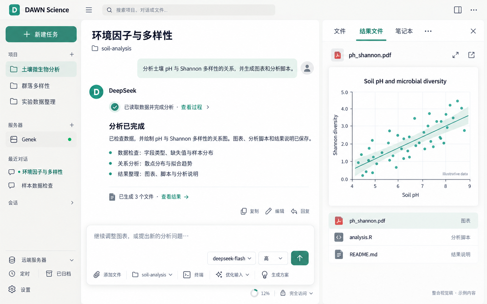
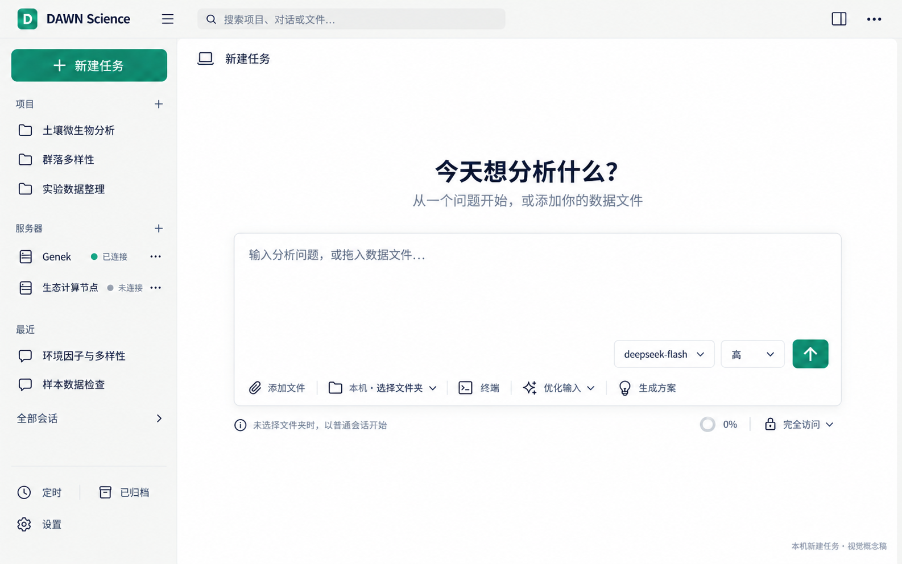
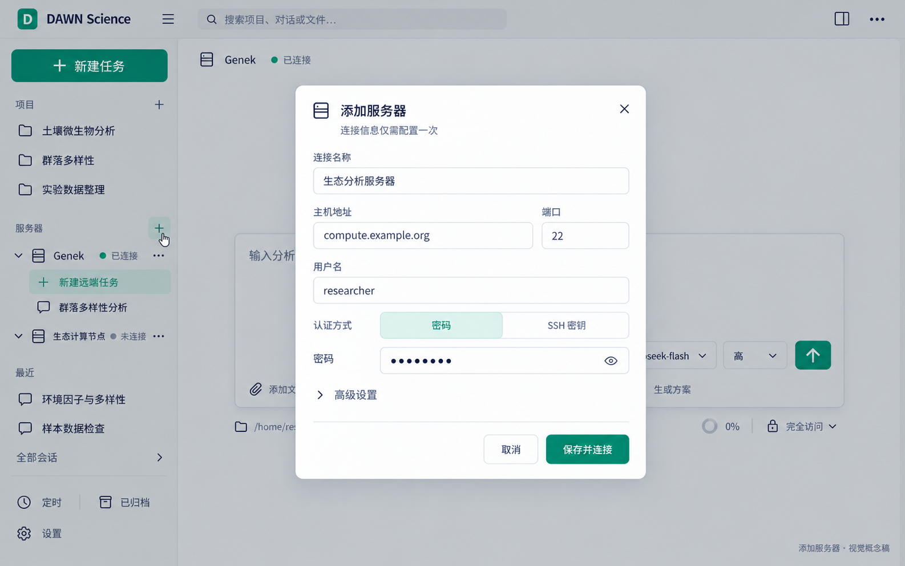
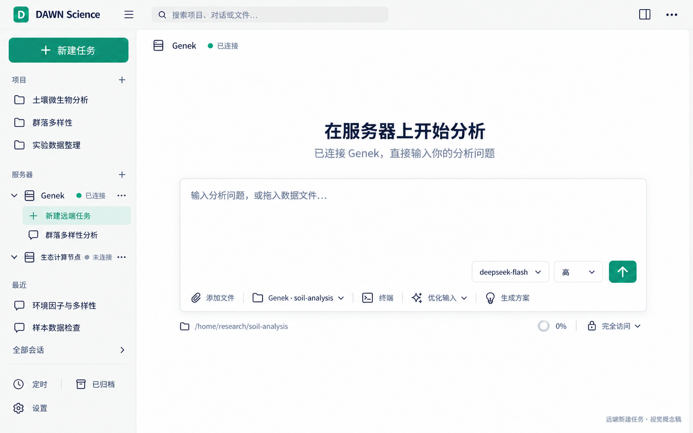
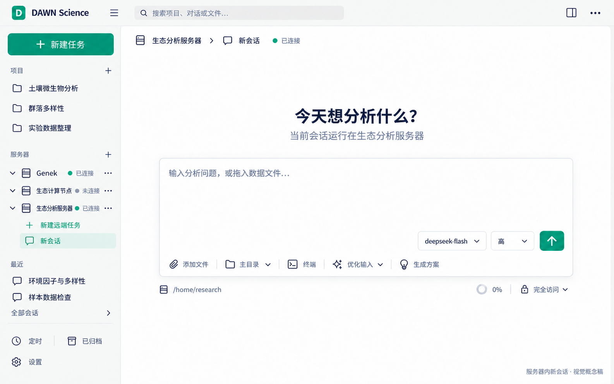

# DAWN Science 页面迭代：确认设计规格

日期：2026-10-11。状态：已在“页面迭代”隔离分支实现首版，真实 Electron 截图待用户审阅；未提交或集成。验证证据与 PDF 已知缺陷见同日验证记录。

本规格整合这轮已确认的视觉和交互决定，取代 [10 月 10 日界面规格](2026-10-10-ui-refresh-design.md)。最重要的收敛是：**本机直接新建；远端从服务器进入；连接管理和远端会话归到同一个服务器区。**

## 1. 整体视觉

默认整体浅色，左侧也使用浅色。暖中性灰外壳、白色工作面、克制的青绿强调色；主对话与右侧共享视觉语言，避免多层卡片、强阴影和满屏绿色选中块。已有用户保存的暗色、跟随系统、自选强调色继续有效。



该图用于整体字级、留白、对话和右侧预览的感觉。**侧栏结构和新建流程以以下四张较新的参考图及文字规格为准。** 图中的科学结果、文件名、用户名、路径和服务器均为示例，不写死进产品，也不作为真实分析证据。

## 2. 左侧导航

```text
DAWN Science
＋ 新建任务                       本机空输入页

项目                         ＋   本地项目及其会话
  土壤微生物分析
  群落多样性

服务器                  添加服务器
  ▾ 生态分析服务器   ● 已连接   ⋯
      ＋ 新建远端任务
      环境因子分析
  ▸ 另一台服务器       未连接   ⋯

最近                              跨收纳快捷访问，保留原显示条件
会话                              普通本机会话

定时 · 已归档 · 设置 · 更新入口     底部轻量工具区
```

- 顺序为新建任务、项目、服务器、最近、会话；项目和服务器占据主要视野。滚动内容与底部工具区分开。
- 合并原“服务器”会话分组与“远端服务器”连接管理，只保留一个服务器区。连接列表是服务器目录来源，不能因为没有会话就不显示服务器。
- “添加服务器”常驻、带文字，旁边可配 `＋`。不只做悬停图标；空列表也提供清楚的文字入口。
- 保留连接分组标签、折叠、长名称提示和原任务批量操作。没有会话的服务器不出现可勾选的空批量选择框。
- 当前会话使用主要选中态，所在项目/服务器使用轻量上下文提示；最近中的同一条不再出现第二块强选中背景。
- 服务器状态用圆点加文字表达，连接失败显示真实原因；上次连接时间保留在次级信息/详情中。断开后历史会话仍在原服务器下。
- 若存在连接记录已移除的历史任务，仍展示其历史分组，注明连接已移除；禁用连接/新建，不静默丢掉历史。
- 定时保留；已归档保留现有按实际归档内容出现的规则；设置和更新入口保持可达。

## 3. 本机新建任务



点击全局“＋ 新建任务”直接进入本机空输入页，可以立即打字。这里没有本机/远端切换向导，没有大型工作位置卡片，也不要求先选目录。

- 不选目录：首次发送后形成普通本机会话，使用该会话的临时工作空间，不继承旧项目的 `@` 文件或远端目录。
- 选择本机目录：沿用现有项目/目录机制，首次发送后归入对应本地项目。
- 单纯点击全局新建不创建空任务、不连接服务器、不发送内容；保留原会话草稿。
- 从远端或已有项目返回本机空页，要明确清除本次新任务的远端归属和旧目录引用；不能只改标题。

## 4. 添加和连接服务器



在服务器区点击“添加服务器”，打开紧凑对话框：连接名称、主机和端口、用户名、密码或 SSH 私钥认证。分组等低频项放入“高级设置”；不额外让用户填写任务信息或工作目录。

| 场景 | 主动作 | 结果 |
| --- | --- | --- |
| 新增连接 | 保存并连接 | 保存连接配置后连接该服务器，成功后关闭弹窗；不创建会话、不切走当前任务 |
| 保存失败 | 保存并连接 | 弹窗保留，显示真实原因，不尝试连接不存在的 ID |
| 已保存但连接失败 | 保存并连接 / 重试连接 | 保留配置、已保存 ID 和表单，显示认证/网络等真实原因；重试复用同一记录 |
| 编辑已有连接 | 保存 | 保存修改，不因改名或改分组自动连接；不覆盖未修改的凭证 |
| 点击服务器“连接” | 连接 | 更新该行连接状态，不自动创建会话 |
| 点击“断开” | 断开 | 保留会话、目录、草稿与历史，按现有恢复机制续接 |

保留原系统钥匙串存储方式。已存口令永不回显；未修改时省略 `secret`，不能发送空串误清除。SSH 私钥模式可填写私钥口令；切换模式不把旧模式的输入误当成另一种凭证提交。保留原连接删除确认、解释器探测及选择入口，高级区域不自动发起探测。

连接中禁用重复提交；不能把“连接中”当“已连接”。失败后的取消只关闭弹窗，已保存的服务器仍留在列表中；无需用户重新添加。

## 5. 在服务器中新建会话





展开服务器后，点击“＋ 新建远端任务”，沿用 `createTask({ agentId, connectionId })`。连接未就绪时沿用后端先连接再创建的能力；失败不创建本机替代任务。创建期间防止重复点击。

- 新空会话出现在该服务器下面；首次发言后沿用已有自动标题机制。
- 主区展示服务器身份与真实连接状态；输入框目录入口显示该会话真实远端路径，展开可查看完整路径，不调用本机文件夹选择器。
- 默认目录取服务器返回的家目录，不写死 `/home/research`；用户通过现有自然语言机制调整当前远端会话的目录，不需要重填 SSH 信息。实施时复核发现当前没有远端目录选择器，直接浏览并设置目录留待后续扩展。
- 多台服务器、主区和侧边会话的连接 ID、目录、草稿、模型状态互相隔离。
- 远端可用模型/ACP 列表继续受真实能力过滤；不支持远端的适配器不因改界面而放开。

## 6. 主对话与输入框

- 助手署名显示**每一轮实际服务商/厂家**，例如 DeepSeek；沿用 `item.by` 身份，不显示统一 DAWN，也不拿当前模型覆盖历史。
- 输入框继续显示精确模型名和该模型实际支持的推理强度，发送键同组，位于白色输入上层右下角；模型/思考触发器无独立描边。下层使用浅灰底栏，文件/目录/终端/优化输入/生成方案在左，会话配置/上下文/权限在右，共用圆角外框，不再有卡外状态行。
- 保留可见入口：添加文件、目录、终端、优化输入及模式下拉、生成方案。窄侧边对话允许换行，不整体隐藏到更多菜单。
- 保留上下文百分比和权限菜单；不添加生成图虚构的独立“标准”下拉。现有优化输入和工作步骤里的 standard 模式保留。
- 保留真实复制、用户原话修改重发、回到这句之前等行为，不照图新增助手编辑功能。
- 保留中文输入法、Enter/Shift+Enter、Tab 接受灰色建议、`@` 文件、`/` 命令、附件、排队和停止；调整布局不重挂输入组件或串草稿。
- 对话中的文件呈现以紧凑摘要与查看结果入口为主，仍可展开原清单；本轮归属、未知产出、已不存在等事实不删减。

## 7. 右侧结果工作面

浅色中性背景，常用三个入口为文件、结果文件、笔记本，其余放入明确的“更多面板”。保留九个内部 ID：`review/files/artifacts/notebook/overview/web/subagent/team/chat`；`artifacts` 只改显示名，不做协议/存储迁移。

结果文件面板以“大预览 + 紧凑真实文件列表”呈现，复用已有 PDF、图片、文本、CSV、HTML 预览和远端下载/外部打开。文件列表数量、种类和名称来自实际结果；无文件、读取失败、缺失文件各有真实状态。长列表独立滚动，不挤掉预览；切换文件的迟到读取不能覆盖新选择。

保留右栏默认关闭、已选面板与宽度的现有语义，产物到达不自动开栏、不抢焦点。默认宽 380px、范围 280–720px；侧栏初始建议 248px、范围 200–420px，已有用户宽度不覆盖。截图校准尺寸，不把生成图的三列比例硬编码。

## 8. 分阶段验收与范围

1. 先看侧栏和三个完整流程：本机新建、添加并连接服务器、服务器下新会话。
2. 再看主对话、输入框、结果工作面组合截图。
3. 最后核对 1280×800、1440×900、1920×1080，暗色、自选强调色、窄侧边对话、键盘和持久化回归。

本轮已获用户授权在“页面迭代”分支实施。实现沿用现有 Electron/React/协议/SSH 核心，不创建新账户系统、工作位置向导、内部溯源系统或 Web 服务端。EcoAI 独立产品派生保留在 [另一份计划](../plans/2026-10-10-ecoai-desktop-fork.md)，不混入本次界面改动，也未创建 EcoAI 工程。

[页面迭代实施计划](../plans/2026-10-11-ui-refresh.md)


## 9. 2026-10-11 最后确认稿（替代此前卡外状态布局）

- 依据：[完整效果图](../../design-references/2026-10-11-final-layout/approved-full.png)、[输入框参考](../../design-references/2026-10-11-final-layout/approved-composer.png)。本节仅确认四项视觉落点，不改变协议和业务行为。
- 首页和主/侧会话输入卡均采用白色输入上层、浅灰辅助下层，共用外框。普通宽度辅助功能与权限/上下文同一栏；窄宽度先缩短辅助文字，必要时底栏内部折行，所有能力继续可达。上下文百分比是占用率，不伪造首页未产生的用量。
- 收纳按钮中心与展开侧栏的右边界对齐，随已有宽度调整；收起后保留原按钮，能原处展开。保留用户已存宽度/折叠偏好。窄侧栏品牌名可以省略，不覆盖按钮。
- 左右面板外表面共用 `--dawn-surface-sidebar`，中间内容和预览纸面保留 `--dawn-surface-panel`；暗色沿用令牌派生，不改用户主题。
- 版本号在全局状态栏最右，关闭右侧面板或缩小窗口仍可见；不放品牌区、输入卡或坞内。
- 用户授权在“页面迭代”分支实施并打开独立开发预览，不授权合并或替换安装版。


### 2026-10-11 补充：文件夹／机器行的新建会话

具体项目和具体服务器各自在“⋯”前常驻写字图标，用于在本项目／本服务器新建会话；折叠时先展开。新建从项目管理菜单移出，避免多一次点击。服务器分区标题的“＋”只添加/配置服务器，不新建会话。此处以用户补充图标为准，取代早先机器行加号说明；左上全局新建仍返回本机首页。


### 2026-10-11 补充：顶部会话标签和状态标记

用户明确美化顶部整排标签及名称前小圆点。用户随后指定以结果文件页签为参考：浅色背景、紧凑等宽方正标签，当前页签用浅灰底、强调色文字和下划线突出，去掉白色圆角卡片。普通灰点隐藏，实际运行恢复原有实心绿点、未读显示色点；关闭用现有图标，键盘进入时可见。保留切换、排序、归档和同处新建，不改右侧 Genek 身份标记。


### 2026-10-11 补充：按钮搜索与独立浮层

顶部仅保留紧凑放大镜按钮，点击在页面上方打开搜索浮层，取代仿输入框与侧栏中的第二个搜索框。浮层统一承载输入、按名字／按内容及结果；项目和会话列原样保留，侧栏收起时也可使用。名字结果显示项目／会话和目录／服务器信息，点选进入原位置；内容结果沿用既有高亮定位、归档打开和跨项目路由。支持自动聚焦、方向键／Enter、Tab 焦点循环、Esc／外部关闭；组词时不跳转。关闭清空查询、回到名字模式，焦点回入口。

### 2026-10-11 补充：快捷键速查

搜索右侧常驻同尺寸键盘按钮，打开只读浮层。按通用导航、对话输入、笔记本／终端列操作与现有组合键，说明运行中、光标边界等生效条件，Mac 与其他平台显示各自修饰键。按钮不执行业务操作、不修改键位，命令面板仍由原 Cmd／Ctrl+K 打开。浮层与搜索共用视觉规格且互斥；自动聚焦、Esc／外部退出与焦点恢复，不侵入用户草稿或导航状态。

用户补充要求明确区分 macOS、Windows、Linux：按当前系统显示实际主修饰键（Mac 为 ⌘，Windows/Linux 为 Ctrl），审阅仍是 Control+Shift+G，终端中断三端均为 Ctrl+C，不能统一替换为 Command。优化输入共用现有平台文案。用三种 navigator.platform 场景核对完整速查键位；本机 Electron 实测只代表 macOS，不冒称已经在 Windows/Linux 真机验收。


### 2026-10-11 补充：侧栏分区对齐与图标颜色

用户指出折叠标题的数量、多选和添加操作不齐，并要求图标有颜色。四区统一箭头、16px 图标、标题固定列和数量列，服务器不再单独使用 max-content 标题列。保留项目/服务器主层级与会话/最近次层级字号，标题列宽以主层级字号计算，避免随字号缩小而偏移。右侧操作统一尾列中心；服务器存在多选时紧挨添加按钮，末尾添加与其他区多选对齐。折叠/展开沿用原实心/描边，颜色只在图标上；项目柔和金、服务器蓝、会话主题青绿、最近紫灰，亮暗由令牌提供。导航、选择、连接状态圆点及上下层缩进不变。

### 2026-10-11 补充：底部导航图标

定时、已归档、设置沿用上方柔和类别色：紫灰、暖金、蓝灰，亮暗由已有令牌提供。设置补现有齿轮，底部三行采用相同的图标与文字左缘，归档计数仍在右侧。只改变图标外观和排版，不改变入口、归档数量或会话数据。

### 2026-10-11 补充：同级图标视觉占位

项目、服务器、会话、最近保持同一 16px SVG 外框和网格列，仅在标题内部校正图形比例：文件夹与气泡适当放大、机箱与圆盘适当收小，视觉宽度接近 13px；圆形略小以平衡视觉重量。描边状态单独校正以包含笔画厚度。颜色、虚实与业务状态不变，其他位置的同名图标不受影响。

### 2026-10-11 补充：常驻主题色外框

主输入卡与欢迎页四张开场建议卡，在未点击、未悬停时也显示柔和主题色外框，沿用已有 dawn-stroke-accent；悬停颜色加深，输入聚焦仍由原 2px 强调色环反馈，不增加内层重复边框。白色正文和浅色工具栏保持，边框包住整张输入卡。默认青绿色，亮暗及自选强调色同步适配。

### 2026-10-11 补充：文件预览优先与空白任务结果

窄坞打开 PDF/图片后，文件树默认至多约三成可用高度，预览优先使用余下空间。保留分隔条，当前视觉模式内用户手动调整优先；自动适配不写坏原保存尺寸，窗口缩小仍保证预览可见。宽坞维持左树右预览。文件面板 PDF/图片适应剩余高度，标题和翻页可见，放大弹窗及结果文件卡不变。

新建任务尚无会话时，“结果文件”直接显示“开始任务后查看结果文件”，不请求不存在会话的产物、不沿用上一段数据、不显示永久加载。已创建会话继续区分真实加载、空清单、失败与未知产物。只处理本轮两处问题。

### 2026-10-11 补充：常驻页签圆点与统一导航色

用户指定会话页签恢复标题前圆点；普通状态为柔和灰点，未读跟随强调色，运行继续用状态色，不因统一图标颜色改变运行或连接含义。左侧项目、服务器、会话、最近及定时、归档、设置的导航图标共用现有外观强调色，亮暗和用户选色即时跟随；保留16px盒子、光学校正、实心/轮廓切换、标题/操作对齐。定时改为同规格描边闹钟，最近仍为时钟。只在页面迭代分支修改，独立预览，不合并或替换安装版。

### 2026-10-11 补充：品牌与三按钮紧凑排列

用户要求缩短 DAWN Science 与收纳/搜索/快捷键三个按钮的间距。品牌槽改为内容宽度，三按钮之间及品牌到按钮使用8px；窄侧栏限制品牌最大宽度并保留省略，按钮32px点击范围不变。此要求优先于旧稿收纳按钮中心固定在侧栏边界，拖宽侧栏不再制造品牌后的空槽。保留折叠/搜索/快捷键行为、左右面板和版本位置。

### 2026-10-11 补充：当前会话圆点着色

当前选中会话的圆点跟随外观强调色；未选中已读会话保留灰点。未读沿用强调色，运行态优先使用 live 状态色，不改变状态判断与尺寸。
