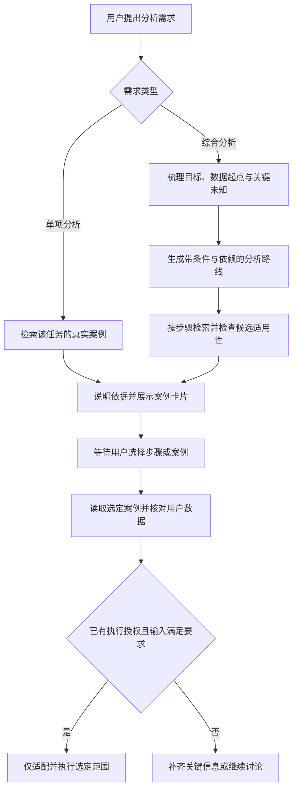

# “照着案例分析”技能增强设计稿

日期：2026-10-17（Asia/Shanghai）。状态：用户已确认设计并选定名称“科研分析向导”；技能已在 `codex/research-analysis-guide` 实施。运行时和界面逻辑未改；工程验证及实际模型未验证范围见验证记录。

## 1. 用户目标与范围

用户自然描述综合研究需求，例如“我要做土壤微生物扩增子测序分析，需要哪些分析？从 MLAI-science 找案例”。DAWN 主动理解需求、组织分析路线、分步骤查找真实案例，让用户通过已有卡片选择参考案例。用户无需先把问题拆成工具查询。

增强已有 `skills/analyze-like-case/SKILL.md`，保留名称、手动调用入口、单项检索和选定后适配数据的能力。首版复用现有 MCP 与卡片，不增加协议操作、不修改 MLAI-science、不新增独立技能或前端路线管理器。

前提：本聊天已完成的 `codex/fix-case-cards` 修复尚未合并或发布。技能实施与验收应包含该修复；设计稿不表示安装版已经具备新行为。

## 2. 方案选择

| 方案 | 内容 | 取舍 |
| --- | --- | --- |
| 增强现有技能（推荐） | 综合需求先组织路线，再分步检索；沿用现有卡片 | 改动集中，可先验证回答质量；卡片统一位于回复底部 |
| 新增专用规划技能 | “规划路线”与“照案例做”分开 | 职责更细，但需要模型判断两份技能及其交接，易重复询问 |
| 新增前端路线面板 | 步骤分组卡片、状态与批量选择 | 阶段关系更直观，但涉及协议、持久化和 UI；作为后续独立需求 |

首版选择第一项。先验证拆解、检索和选择能否帮助用户，再决定是否增加前端面板。

## 3. 交互流程

### 3.1 需求分流

- 单项需求：如“找几个 NMDS 案例”“R 里怎么做随机森林”，保留原来推荐 3–5 个案例的简洁路径，不强行生成全流程。
- 综合需求：如“需要哪些分析”“整个项目怎么做”“帮我设计完整分析路线”，进入路线拆解路径。
- 已选择案例：识别卡片发送的完整 `case_id`，或当前推荐清单中的序号、标题；对回它对应的步骤，继续该步骤。
- 概念解释、单图模仿与最终交付整理：继续遵守现有技能边界，不把所有问题都纳入本技能。

### 3.2 先理解数据与研究目标

复用本会话已有的信息：研究目标、数据起点、分组/重复或配对关系、语言与环境偏好、用户希望了解路线还是实际执行。

对于扩增子示例，原始 FASTQ 与已经获得 ASV/OTU、分类及样本信息表是不同起点；16S 与 ITS 不应被悄悄当作同一种输入。此处是需求辨识，不预设具体实验方案。

- 仅影响细节的未知：先给条件化路线，明确适用前提，继续有价值的检索。
- 会改变主路线或造成错误匹配的未知：集中询问至多三个关键问题；已知信息不重复问。
- 用户明确只想先看概览：允许给分支路线，不要求先提交全部数据。
- 不虚构样本数、分组、处理过程、数据路径或实验设计。

### 3.3 组织路线

由模型根据研究目标与数据起点组织领域步骤，使用本次回复内稳定的 `S1`、`S2` 等编号。每步写明：回答的问题、所需输入、预期输出、前置依赖、适用条件。

将步骤区分为“当前目标的基础步骤”“满足条件时适用”“研究问题驱动的拓展”。未知实验信息时不把“基础”解释为对所有研究都必须采用某项具体统计方法。

科学路线由 DAWN 组织；MLAI 的 `preprocessing/training/evaluation` 是其建模推荐阶段，不是所有科研问题的通用路线。不把生态或组学流程硬套成机器学习训练流程。

### 3.4 分步骤检索

1. 从实际工具清单确认 MLAI 工具可用；必要时通过 `list_taxonomy` 获取真实任务、算法、库和图型 ID。
2. 每步组织具体查询，调用 `search_cases`，初次默认取 6 个候选；明确的语言、算法或库要求作为过滤条件。不要只把整个综合需求搜一次就结束。
3. 初筛不足时，采用同义表达、关键词/融合检索或 `search_chunks` 查单步骤。放宽主题标签应披露；用户指定的硬性条件不能悄悄去掉。
4. 只在适合建模的问题中使用 `recommend_pipeline` 辅助找候选；领域路线不能直接照抄其固定阶段。
5. 每步最多展示 1–2 个代表候选，综合需求首次回复默认最多 8 个不同案例；有意未展开的步骤明确标注“未展开”，不能写成“库里没有”。用户要求全面盘点时另行分页检索，不能将首批命中数称为全库总数。
6. 查询为空、调用失败、缺少鉴权、服务不可用分别说明。查询为空不等于库为空；不自动重建语料、重启服务或改配置。

### 3.5 检查候选内容与证据

推荐依据从真实工具返回中获得：ID、标题、语言、任务标签、方法片段、输入要求、图件与说明。区分“完整流程参考”“单步骤分析参考”“结果可视化参考”。不以标题、排名第一或 `category` 单独判定案例适用。

证据分两维展示：

- 检索状态：已查找到 / 已查未找到 / 调用失败 / 尚未展开。
- 内容核对状态：仅元数据初筛 / 已核对相关内容 / 输入或设计仍待确认。

初筛可利用 `search_chunks` 的实际片段或 `recommend_figures` 返回的方法要点。需要确认输入、方法或步骤覆盖时，允许对少数候选进行只读 `get_case`，默认每轮最多 2 个不同案例并缓存本轮结果。此规则替代旧技能“选择前一律禁止 get_case”：只读核对不代表替用户选择，也不授权运行案例。

`get_case(figure_limit=0)` 仍可能返回很大内容；只声明实际读到的部分，截断时不能宣称已完整核对。不把 `search_chunks` 当成支持任意 case_id 定向读取的接口。信息不足的候选标为初筛，不编造输入要求、样本量或验证结果。

`verified` 表示案例整理/结构校验状态，不等于在用户数据、当前环境下运行通过或科学结论得到独立验证。同步移除现有技能里固定案例数量及“全部都跑过”的过时断言。

## 4. 首次回答长什么样

按以下顺序输出：

1. 用一小段确认对需求的理解，并列出影响路线的少量已知条件和未知条件。
2. 分析路线表：步骤编号、目的、输入/前置条件、预期输出、适用性、案例编号或检索状态。
3. 推荐案例清单：全局编号 `C1`、`C2`，真实完整 `case_id`、原始标题、语言、对应步骤、推荐理由、覆盖范围与核对程度。
4. 说明暂缺案例或未展开的步骤及下一步查找方向。
5. 邀请选择：“先展开 S3”“看 C2”“照这篇做”“调整路线”均可。

扩增子问题的输出组织可示意为：输入准备与起点确认 → 群落概览 → 多样性相关问题 → 分组差异相关问题 → 环境关联相关问题 → 研究目标驱动的拓展。具体方法、顺序及是否适用取决于研究设计；这里不把示意路线作为预设的最终科学分析方案。

## 5. 卡片与选择语义

- 首版复用现有卡片：它们统一位于回复底部，不承诺按步骤嵌入或分组。路线表与候选清单负责表达步骤对应关系。
- 正文按步骤首次出现顺序列真实完整 ID；卡片同序出现。同一案例跨多个步骤复用时只展示一张，在文字中列明对应步骤。
- 当前渲染器根据“本轮工具查到且正文提到”的案例生成卡片。因此默认不在正文顺带列出所有被淘汰案例的 ID，以免出现不供选择的卡片。
- 本轮新增卡片只来自当前轮推荐范围，旧回复里的卡片继续保留。后续“展开 S3”重新检索或读取该步骤候选，确保当前轮有对应工具数据。不能只复制上一轮标题并承诺出卡。
- 卡片有封面时显示真实封面；缺图/取图失败沿用已有明确提示。
- 点卡片主体查看详情；“照这篇做”仍发送完整 ID。
- 选择确定的是该案例及其对应步骤，不代表选择整条分析路线。一个案例对应多个步骤且意图不明确时，只询问这一个歧义。
- “第 2 个”按最近一份明确编号的候选清单解释；清单不清、上下文缺失时不猜。

## 6. 选择后与执行边界

读取选中案例的代码与说明，核对用户数据是否具备所需输入，解释需要适配的部分与当前不能做的部分。案例不适配时说明原因并重新推荐。

- “先看路线/先讨论/先设计/暂不运行”持续约束后续行为，直到用户改变执行范围。
- 单纯查看详情不执行；“先展开 S3”默认只解释、检索该步骤。
- 用户明确“照这篇做”，且已有所需数据及运行授权时，继续选定步骤；不再为已授权普通动作逐次询问。
- 缺少输入或存在实质方法歧义时先解决该条件；不猜路径，不直接运行案例附带示例数据，不自动安装依赖或把所有阶段一并执行。
- 延续现有新脚本、引用 case_id、保护原始数据及失败如实报告的规则。最终交付整理仍由 `analysis-delivery` 按用户要求触发。

## 7. 实施边界

计划修改：`skills/analyze-like-case/SKILL.md` 的 description、需求分流、路线/检索/核对步骤、选择语义与执行边界；补少量按需加载的示例和验收场景；补技能加载与卡片链路的相关测试。更新旧设计与开发历史。

description 扩展“综合需求、完整分析路线、需要哪些分析”等触发语义，仍保持技能名不变。技能依旧由模型选择或用户通过 `/skill:analyze-like-case` 显式调用；改 description 能改善发现，不保证任何模型对所有自然语言都必然加载。首版不新增强制路由器。

技能要求属于行为指导，不能代替已有执行权限门；同样不应声称只改 Markdown 就获得确定性的科学判断或新的前端能力。

## 8. 验收

| 场景 | 必须观察到的行为 |
| --- | --- |
| 综合问题、信息少 | 给条件化路线或只问必要关键问题，不虚构实验设计 |
| 用户已给数据起点与语言 | 从该起点组织路线，避免重复询问和无关前处理；保留语言硬约束 |
| 单项分析 | 保持 3–5 个案例的简洁路径，不强制展示全流程 |
| 分步检索与部分缺口 | 每条候选 ID 真实存在；“未检索”“未找到”“失败”区分清楚 |
| 纯绘图案例混入 | 说明只能参考作图，不能冒充完整分析流程 |
| 跨步骤复用同一案例 | 卡片去重，文字保留步骤映射 |
| 后续展开某一步 | 当前轮有相应检索/读取记录和卡片，其他步骤不被视为已选择 |
| 用户选择或更换案例 | 对回正确步骤；歧义最小化澄清；不自动运行整套路线 |
| 只讨论或未提供数据 | 不调用执行工具、写分析脚本或运行示例 |
| MCP 未接通或命中为空 | 不伪造案例，不自动改库或服务配置 |

验证分层：静态合同测试检查技能边界与格式；隔离 Electron + 同一份 mock 验证手动技能展开、真实工具数据和卡片/选择链路；真实模型试用评审路线合理性、分步骤检索与适用性说明。mock 应答和字符串扫描不能证明模型实际规划质量。真实模型试用需另按用户确认的实施/测试范围进行，本轮未开展。

## 9. 当前交付状态

设计时只读核对了既有技能、MCP 参数/返回说明、卡片与技能加载测试及讨论/执行边界。用户随后授权实施；计划见 `../plans/2026-10-17-research-analysis-guide.md`，工程验证和实际模型质量试用的边界见 `../../reviews/2026-10-17-research-analysis-guide-verification.md`。
