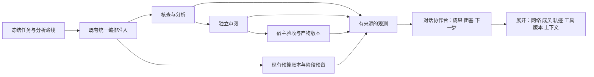

# DAWN 科研协作 P1—P4 设计

日期：2026-11-07。起点：main `9cc757cc`，功能基线 `c5d4d568`。用户已选择按上一轮优先级 1—4 逐步设计、制定 plan 并建立 goal；本文件细化该方向。本文记录设计基线；后续执行状态与证据见 `docs/validation/research-collaboration-p1-p4-20261107/README.md`。新真实模型调用仍需另行授权。

## 目标与交付边界

让科研任务从委派到审阅、验收、产物交付形成可检查的闭环，同时能回答：卡在哪里、还有多少委派轮次、已验收哪版结果、当前上下文与累计消耗分别是多少。沿用统一编排、冻结契约、真实工具记录、产物版本/锁、流水线、取消排空和恢复机制。

既有事实：最新真实试验转发 27 次，single 14 次 accepted，multi 13 次未交付。末轮提交引导和冻结修复在该实测后完成，尚未复验。最近一次完整相关回归 6459 项 Node/UI、50 项 kernel、27 项 Electron 通过，但不能据此宣布模型质量收益。原始报告与失败记录不覆盖写。

不包含通用后端注册表重建、完整 fork、递归委派、全新调度器、安装包替换、发布。独立审阅继续使用独立会话与真实读取，不能因继承分析结论而省略审阅。

## 方案取舍

1. 采用：按交付评测 → 正式阶段预留 → 成果与阻塞界面 → 上下文观测推进。每阶段独立验收、展示、复审，能单独保留或回退。
2. 预算/展示全部做完后统一评测：会延迟暴露真实提交失败，不采用。
3. 直接移植 harness 的运行时和图形界面：会重做 DAWN 已有科研验收与恢复，不采用。仅参考后端能力说明、日志投影、可观察性与交互组织。

## 总体结构



评测只观测并核验真实文件，不修改生产账本。展示只消费投影，不决定任务完成或重试。测量不得授予额外权限。预算与预留的原子变更继续写入同一个 orchestration state。

## 阶段 A：审阅交付闭环与真实复验（优先级 1）

沿用四类 `researchTasks`：已知单位且含缺失值、单位未知应阻塞、小样本已知均值、分层数据禁止错误筛选。离线覆盖全部任务，测试缺字段、超出冻结集合、重复路径、错误引用、输出截断、取消与预算耗尽。

沿用 submit_task_result、冻结 schema、宿主反馈；不代模型补 reviewedPaths、引用 ID、pass verdict，不扩大 4096 输出上限掩盖问题。完整说明保留在已有报告/工具记录；提交只包含必要结果与证据。

评测将宿主接收/退回、SDK 拒绝、输出截断未执行分开列出。可从原始记录可靠观察到的才计数，无法识别时为 unknown；历史 host-only 字段口径保持。冻结 provider/model、采样设置、工具/权限、输入、产物规则、候选源码/构建及每臂额度，禁止换模型或改请求方言形成伪对照。

联网先准备可审阅的任务清单与逐臂账本。新的 API 请求额度须另行明确授权，旧 30 次试验已经结束，不滚存剩余 3 次。首轮建议最多 30 次、每臂 15，仅一个代表性配对；多任务或重复试验必须有对应的明确总额度。失败亦为有效试验结果，不以多 Agent 必须胜出为完成条件；小样本只报告观察，不推断普适优劣。

交付：版本化评测报告、原始结果与失败原因、可复核文件数值与版本、预算门最终 inFlight=0。演示一条 accepted、一条正确 blocked、一条未完成提交；联网结果与夹具结果分开。

## 阶段 B：正式任务阶段预留（优先级 2）

第一版仅为本地受支持的科研流水线提供可选“保留独立审阅执行轮次”；默认关闭，旧任务行为不变。执行轮次是一条任务尝试/子会话轮次，不等于一次模型 HTTP 请求。首先支持每个核查—分析—审阅周期预留 1 个 review 执行轮次，多个并行周期各自持有一份。

前置条件：用户显式设置 maxRuns 并启用审阅预留；线性三阶段流程的首次可用执行轮次不足 3 时，在任何模型/工具副作用前明确阻塞。第一版不提供硬 token、人民币或 HTTP 请求预留；现有 token 结算、未知用量和总历时约束仍生效。

将预留记录作为同一 BudgetRecord 的可选扩展：稳定的 owner/session、pipeline、修订周期标识、stage=review、状态与剩余轮次。旧记录缺字段按无预留读取；完整协议校验和恢复测试同批加入。非审阅准入不能花掉 held 的轮次；审阅准入在同一原子变更中扣除实际 consumedRuns 并消费对应预留。不能跨会话、跨流程、跨修订周期消费。

前序取消未启动任务不收费；已准入按现有规则计账，不退款。停止流程后，未用预留只在相关执行排空并确认终态后释放。重复停止/结算/恢复必须幂等。崩溃恢复不自动清零已用额度，不自动重启模型；未结束流程的预留标为待核对并继续占用，显式恢复核验或终止释放走现有控制与权限入口。旧尝试的迟到结果不能消费新预留。

受保护审阅返回 revise 后：旧周期已消费的轮次不退款；新修订周期先重新核算完整后续执行与审阅需求，额度不足就受阻，不挪用其他流程的额度。调整限额沿用 setRunBudget 的 expectedRevision；降低上限不强杀在途执行，不使旧预留凭空消失。

展示：总已用、可供普通阶段使用、审阅预留、在途、恢复待核对。文案始终写“执行轮次”，另外显示 token/历时限制；不得写成“保证审阅一定完成”。

## 阶段 C：成果与阻塞优先的协作界面（优先级 3）

保留“对话协作台”为主界面、“流程工作台”为展开视图。首屏依次呈现任务目标、当前阶段与验收、首要阻塞、下一步可采取的动作、已验收产物及其版本。成员网络、原始工具记录、交接细节仍按需展开，旧入口保留。

示例信息结构（所有值来自真实投影）：

```text
目标：按确认的方法完成数据分析
阶段：分析已验收，审阅待正式提交       验收 2/3
预算：普通阶段剩余 1 轮；审阅预留 1 轮
需要关注：审阅引用的文件不属于本轮冻结输入
下一步：[查看提交反馈] [查看冻结输入]
已验收产物：[报告预览] [结果表] [脚本] [对应版本]
[展开流程工作台：成员 / 任务依赖 / 轨迹 / 工具 / 交接]
```

制作单一只读 presentation selector，把已结束、已验收、未审阅、停止排空、历史未知分开。旧执行的 accepted 不能成为当前尝试的成果。动作第一版只导航现有检查入口；涉及恢复、取消或预算调整的写操作仍由原宿主权限与版本守卫决定，不从 UI 自建重试流程。

复用 useRunOverview 的 client/session 共用订阅和单个在途读取。增加有 owner/revision 的变更通知，收到后合并拉取；保留当前 2 秒轮询作兼容兜底。通知到达读取中时安排一次尾随刷新，取消订阅/切会话后丢弃迟到结果。图、列表、计数、详情共用同一快照修订，状态更新时不丢当前页签、选中成员或返回焦点。

验证 dark/light、900px 窄窗口、空任务、多个流程、旧入口、展开返回、运行到结算、阻塞到修正、取消排空、重启后的历史标记。截图必须注明合成推理，不能用截图证明科学正确。

## 阶段 D：跨 Agent 上下文与消耗观测（优先级 4）

复用 NativeRuntime.contextUsage、既有 ContextMeter、TaskUsage、子进程事件、run overview 和会话用量数据。给支持的成员增加有来源和时间的当前上下文读数；不从累计 input/output 推算当前上下文，不把历史旧读数标成实时。

读数绑定 owner/session、childId/epoch 与 provider/model，含 observedAt、available/unknown、usedTokens、contextWindow、source。来源至少区分 provider 实际读数、SDK 估算、未知；缺字段保持缺失。系统/工具/消息组成仅在有可复核的 retained/request surface 时估算，并标明“组成估算”；没有来源时不渲染彩条，也不读取或展示隐藏推理。

累计消耗继续按现有 input/output/cacheRead 口径并标部分/未知；与“当前上下文占用”并列但不混合。调用失败、取消、重启、换模型后都处理失效与时间标记。只支持有证据的后端；ACP 或历史记录没有读数时显示不可用，不复用主会话值或猜为零。

第一版不新增价格管理、汇率或计费后端。仅在现有调用记录已提供费用时显示其来源；若已有明确单价与完整用量，可生成注明单价版本、币种和未含项目的估算。其余显示“费用未记录/无法估算”，不得把 trial 模型配置中的占位零价格当真实免费。

演示同一任务的当前上下文、累计 token、估算组成与未知状态；同时展示切会话、换模型、取消和重启后的失效行为。对敏感内容只投影计数、身份和允许的说明，不新增原始 prompt、凭证或私有数据副本。

## 共用验收与安全约束

每阶段：先行为失败测试，再最小实现，定向测试，必要构建/类型及相关 Electron，独立代码复审；阶段收尾跑完整 Node/UI，涉及内核则串行 kernel。完整桌面与跨平台不自动宣称通过。保留首个失败日志、源码/构建指纹、运行环境与测量口径。已通过的检查只有新改动、失败或剩余关注点才重跑。

阶段产物写入独立 validation 目录，给用户展示一张实际截图/轨迹或一份可核验指标表。每次说明“改了什么、用户收益、实际验证、尚未验证”。实现与证据可在专项分支保存；当前授权不自动 commit/merge/push/release。main 与已安装 App、正式配置/凭证/数据库保持不变。

历史偶发退出问题持续 OPEN：首轮约 7.35s/20.69s，独立复测约 136.8ms/147.9ms。新增变更沿用双侧退出诊断，不提高原 1500/4000ms 预算和测试阈值；退出码 0、复测正常或新日志不能证明旧根因已解决。若新证据可复现且定位，则单独提出并修复；不能把无因果证据的改动包装为历史修复。

## 阶段完成标准

A：离线任务矩阵、可靠的分类计数和可审阅联网包完成；获得新额度后完成受限配对并如实交付结果。B：预留在正常、并发、修订、取消排空与恢复中均不超支、不串用，旧数据可读。C：真实状态、成果、阻塞和下一步在主视图可见且联动正确。D：当前上下文、累计用量、估算与未知可区分，并通过身份、失效和隐私验证。

整轮完成要求四阶段分别有代码、测试、独立审查、效果展示和限制记录。联网部分等待额度时可继续其他离线工作，但不得把未做的真实复验标成完成；也不以模型必须改善或历史超时必须消失作为验收条件。
