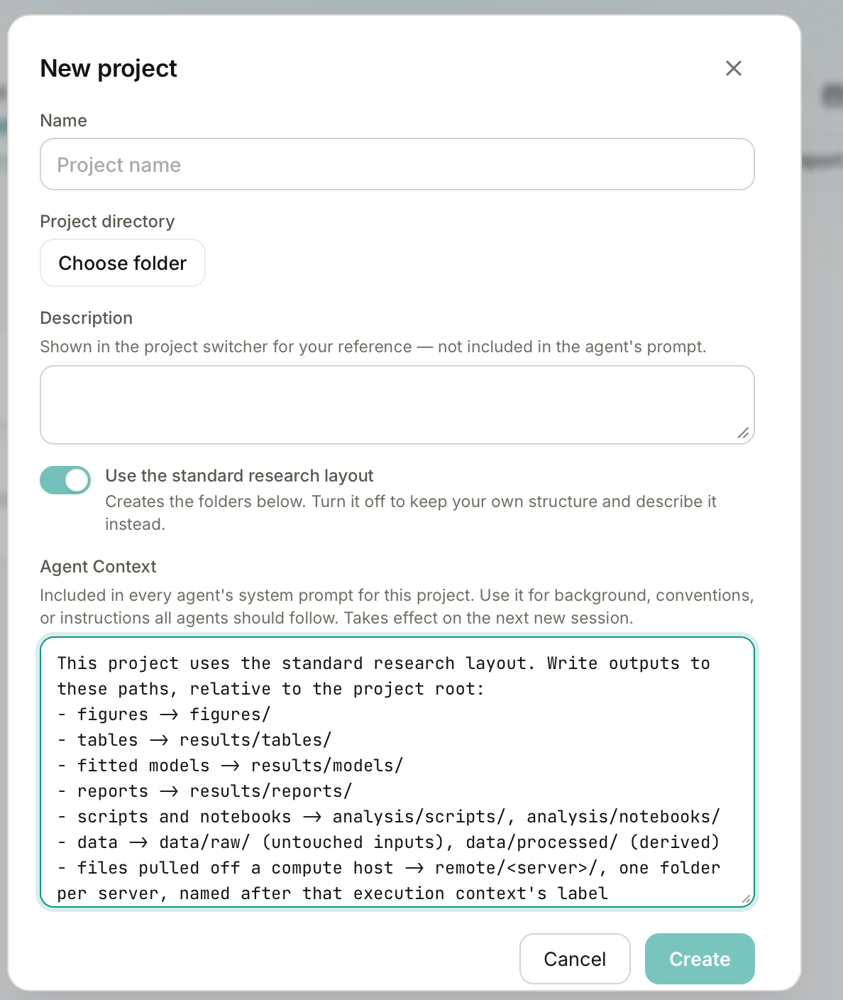

# 新建项目与目录：后续开发参考

状态：用户于 2026-11-16 认可并要求记录，供后续开发遵循。本次只保存参考与需求，不表示功能已经实现。



## 认可的交互方向

首页增加独立的“新建项目”入口，与当前“打开项目”（选择已有目录）区分。采用简洁弹窗，沿用 DAWN 的主题、表单、按钮和图标风格。

- 项目名称：可填写名称。
- 项目目录：通过本机文件夹选择器指定位置，明确显示目标路径。
- 项目描述：用于项目列表或切换器中辨认项目，不自动加入 Agent 提示词。
- 标准科研目录布局：提供可选开关；关闭后保留用户自己的目录结构。
- Agent Context：独立填写项目背景、约定与所有 Agent 应遵循的指示，按项目作用域注入后续新会话；与仅供界面展示的描述分开。
- 底部保留取消与创建，右上角可关闭。

## 参考中的标准科研目录

```text
项目根目录/
├── data/
│   ├── raw/               # 原始输入，保留原样
│   └── processed/         # 处理后的派生数据
├── analysis/
│   ├── scripts/           # 分析脚本
│   └── notebooks/         # 笔记本
├── figures/               # 图形
├── results/
│   ├── tables/            # 表格
│   ├── models/            # 拟合模型
│   └── reports/           # 报告
└── remote/
    └── <server>/          # 按服务器区分取回的文件
```

标准布局启用后，Agent Context 可带入相对于项目根目录的输出位置约定，用户可查看和编辑。实际开发时需复用 DAWN 已有的目录、项目上下文、产物和远程下载机制；已有文件不能被初始化操作覆盖或移动。

## 后续实现前需细化

明确“选择父目录并创建项目子目录”与“直接使用所选目录”的关系；定义重名、已存在目录、失败清理，以及项目上下文对主 Agent、子 Agent 和不同运行时的具体支持范围。这些属于下一次实现的设计与验证工作。

本轮首页功能和四步引导顺序保持当前实现；不在本次记录中新增项目创建逻辑。
