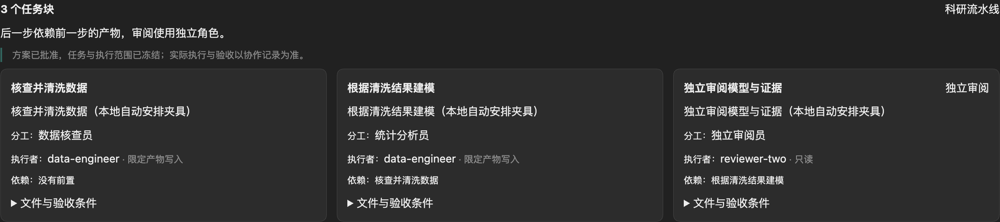

# 协作台状态与自动安排评测：本轮实证

工作区 `/Users/liuyue/.codex/worktrees/dawn-collaboration-evidence-20261108/dawn-science`；分支 `codex/collaboration-evidence-20261108`；起点 main `899463dd`。本批候选未提交、未合并、未推送、未发布，正式 App 未替换。

详细方案：[实施计划](../../superpowers/plans/2026-11-08-collaboration-evidence.md)、[设计](../../superpowers/specs/2026-11-08-collaboration-evidence-design.md)。[代码自审](../../reviews/2026-11-08-collaboration-evidence.md) 是单线自审，不冒充独立审查。

最新状态（2026-11-09）：**本轮已获授权并完成148/300次真实模型调用，12组全部结束，调用已排空**。结论见[真实结果与失败解释](live-results.md)：目前没有证明自动多Agent更省或更稳。原始v2冻结报告保留，补充v3修复一处评测输入绝对路径漏判，离线复核新增调用0次。v3六题离线报告/独立文件复算通过；最终同一完整集合在4个worker下710文件、7053通过/11跳过（272.62秒），typecheck/build退出0。默认并行曾有一项24组长评测超过原60秒，失败日志保留；未改阈值或减少用例。

## A：界面实际改了什么

方案卡和自动安排区域使用同一方案状态。批准后说明“任务与执行范围已冻结”，不再仍称“待执行”；开始和验收仍以既有实际执行记录为准。替代、弃用单独说明。任务安排用可换行的网格卡片展示分工、执行者和依赖，输入输出与验收可展开；窄窗、依赖图、详情返回和恢复沿用已有路径。

截图来自真实 Electron + localhost 模拟模型，界面中的 3 个任务是该演示题的方案结果，不是默认数量。六类规划场景实际出现 1/2 块和 single/parallel/chain。

## B：自动安排与科研题集

[六类规划报告（最新）](arrangement-scenarios-v2/arrangement-scenarios.md)：真实 Native/propose_plan 路径，单结果、独立输入、产物依赖、独立审阅、缺少信息、明确只读六类全部通过声明检查。只记录方案、不批准执行。评价覆盖明确声明的关系，不代表任意自然语言规划质量。

[六题同预算执行报告（最新）](research-fixture-v3/research.md)：每组最多 25 次，自动组工作含规划 18 / 独立审阅 7，组间不借额度。保留 12 组实际文件工具与 Python 执行，6 个完整合格配对；每组 5 个合格交付、1 个缺单位正确阻塞，0 个错误放行。总共 70 次 localhost 推理请求，最终 inFlight=0；**真实 API 请求 0 次**。

新增负值/零均值与重复站点题：两组分别交付 n=3、mean=0、unit=V 和 n=4、mean=4、unit=mg/g。原始输入全部保留。[独立文件复算（最新）](v3-independent-file-check.json) 用 Python 重新读取 CSV、计算实际结果并核对 30 个产物版本哈希，未调用产品 judge。

这组简单题中 single 每个合格交付平均 4.40 次请求、multi 9.60 次（分子包含正确阻塞成本）；不能据此声称多 Agent 更便宜或真实模型质量提高。

## C：阶段用量

新 phaseUsage/totalUsage 包括规划、执行、审阅，旧 usage 保留执行任务口径；缓存读取单列，不再次计入输入输出。缺少回执、partial、未运行分别报告，不换算费用。

| 本地回执样例 | 规划 | 执行 | 审阅 | 合计 |
|---|---:|---:|---:|---:|
| carbon-missing / single | 未运行 | 80 | 未运行 | 80 |
| carbon-missing / multi | 20 | 80 | 80 | 180 |
| unknown-unit / multi | 20 | 40 | 未运行 | 60 |

以上是可复算的测试回执 token，不是生产花费。部分缓存字段标记 partial，报告保留该覆盖信息。

## 验证与保护边界

- `frozen-typecheck.log` / `frozen-build.log`：退出 0。
- `final-vitest.log`：710 文件，7050 通过、11 跳过，180.66 秒；包括六题各两次的 24 组/12 配对集成测试。这与上方另存的 12 组/6 配对报告是两个运行，不能混算。
- `final-desktop.log`：14 个规格文件、41 项全部通过，3.9 分钟；含主/展开视图、900×640、方案调整/恢复、会话隔离、取消、旧 Bot/subagent/普通方案及两个终端退出恢复。`exit-summary.json` 记录 51 个关闭到进程退出样本，最大 406.48ms，退出码全部 0，无原生收尾异常；不能据此关闭历史偶发问题。
- `candidate-sha256.json`：冻结 1659 个 src/scripts/e2e/tests 文件；保留 red/green 和初次失败证据。没有用快照更新掩盖界面问题。
- 正式 providers.yaml、credentials.json、dawn.db 只记录哈希，不复制私有内容；最终核对见 `final-boundaries.json`。

## 真实模型复验：已按本轮授权完成

[详细结果](live-results.md)、[原始冻结报告](live-01/research.md)、[独立文件校验](live-independent-check.json)、[评测路径修正离线复判](live-offline-read-recheck.json)。授权见live-authorization.json；请求门forwarded=148、denied=0、inFlight=0，宿主退出0。三题两组各重复2次；每组最多25，自动组工作18（含规划）/审阅7，没有借额度、失败重跑或为用满300追加调用。

带单位任务合格交付单执行者3/4、自动安排2/4；缺单位题按严格标准并修正路径漏判后，正确阻塞单执行者1/2、自动安排0/2。两组均合格配对2/6；错误放行均0。成功配对中自动组增加了独立审阅，也用了更多请求/时间。只有2个成功配对，不能形成普遍质量/费用结论。

原始模型执行属于候选v2，冻结时source与child/config不变；v3仅修复评测识别成功read绝对路径的漏判，另存离线复判，不覆盖原始报告，不冒充v3重新联网结果。未完成审阅、漏带acceptance、字段不一致和澄清问题均如实保留。

## 历史问题仍 OPEN

历史 7350/20690ms 偶发退出、长 Bot/MCP 收尾、PTY 清理和旧宿主重载截图失真继续留样跟踪。1500/4000ms 阈值不变；本轮正常样本不关闭历史问题。

## 可操作候选演示

已从本专项 dist 启动独立 Electron，工作区名“DAWN-协作台新迭代-模拟模型”。`prepare-demo.mjs` 为可复查准备入口；只使用独立临时配置/数据库和 localhost。已真实生成、批准并验收 3 项任务（11 次模拟请求），实际验证 Escape 返回，再展开保留供查看。图见 `candidate-demo.png` 与 `candidate-conversation.png`；不替换正式 App。关闭该演示窗口会结束它自己的模拟服务。

## 离线验收历史（v2）

[逐项完成审计](completion-audit.md) 发现并补齐规划场景独立 reviewCovered 字段；red 2项失败、green 8项通过，最新六场景报告明确区分覆盖完整/不足、无需审阅和无效结构。`audit-layout-reachability.log` 新增真实 Electron 长标题/路径验收通过，首尾可滚到、全文无内在裁切，展开返回保留；长字段高于视口时并不宣称一屏显示。

新候选冻结在 `candidate-v2-sha256.json`，1664个文件（包含CSS与依赖清单）；原有候选、报告、失败日志和trace均保留。最新科学报告是v2目录；旧报告属于第一次冻结，不能拿旧source fingerprint冒充新候选。审阅字段补齐后再次跑完整Vitest和typecheck，最终日志见audit-final-*；该时点原有UI实现没有修改，41项桌面结果继续适用于同一UI构建，另加长内容用例。当时0次真实调用、等待新增答复；该阻塞已由用户本轮300次授权解除，实际结果见上方真实模型部分。

v2边界核对：`audit-final-boundaries.json`；当时完整回归：`audit-final-vitest.log`；类型/构建：`audit-final-typecheck.log`、`audit-final-build.log`。历史数字与原始日志保留；当前最终结果以v3和真实结果章节为准。

## 最终收口（2026-11-09）

`completion-state.json`记录最终边界与验证：1668文件冻结、原始live报告、main及正式配置/凭证/DB全部核对不变；专项分支无提交/合并/推送/发布。实际148次、在途0次，本批次已结束，未为用满300追加试验。v3-final-vitest-workers4.log为完整7053通过/11跳过；v3-typecheck/v3-build退出0，41项相关桌面与新增1项长内容保留各自运行证据。历史退出/Bot/MCP/PTY与本次默认并行长测试超时继续跟踪，不能视作已根治。
