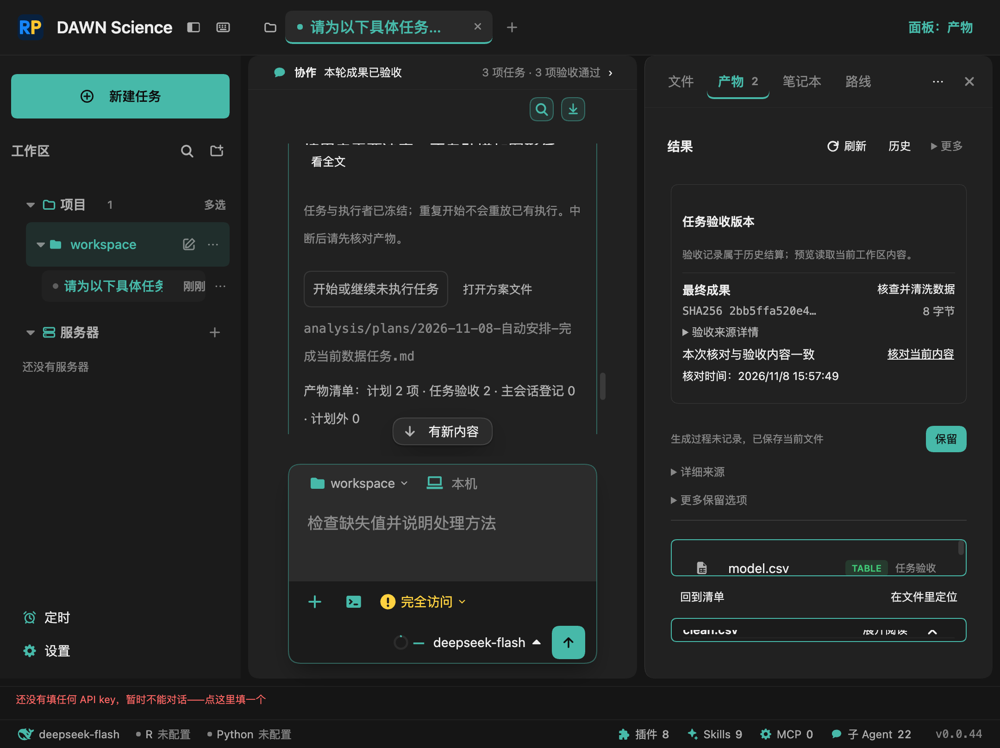
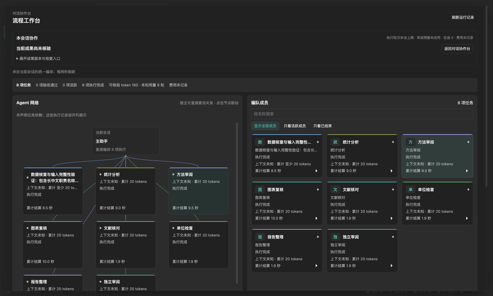
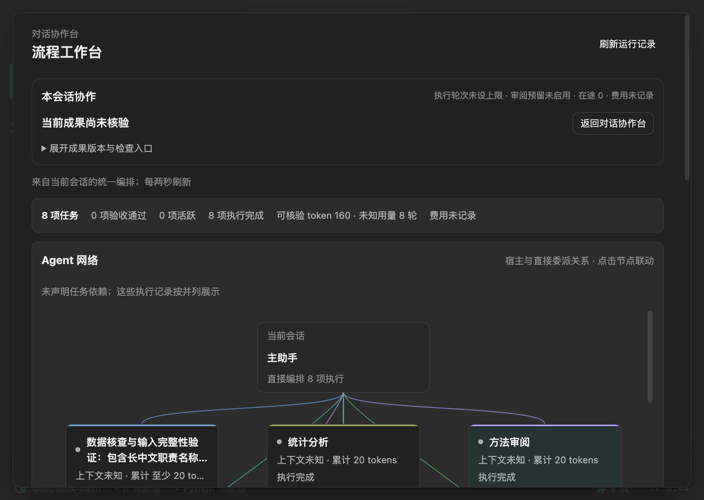

# 预算内交付与成果协作台验收

候选：`codex/delivery-convergence-20261108`，基线 `646bcc1aa7153dfa03f112d879033141dfea299a`。隔离目录 `/Users/liuyue/.codex/worktrees/dawn-delivery-convergence-20261108/dawn-science`。本轮不提交/合并、不推送/发布、不替换正式 App。

[详细计划](../../superpowers/plans/2026-11-08-delivery-convergence.md) · [设计](../../superpowers/specs/2026-11-08-delivery-convergence-design.md) · [代码自审](../../reviews/2026-11-08-delivery-convergence.md) · [查看效果/使用步骤](usage.md) · [完整实际命令](commands.md)

## 实际改动

| 阶段 | 用户和执行者现在能做什么 | 权威来源与边界 |
|---|---|---|
| A1 交付检查点 | 原生契约子任务/Team执行者可查询缺少的读取/执行/审阅证据；工具进展变化给出简短提交提醒 | TaskSubmission 原账本，只读、不增加提交次数；正式提交和宿主验收照旧 |
| A2 预算与自动安排对照 | 同题同预算真实试验可走模型自动安排，规划请求计入共享工作额度；每请求收到真实剩余额度 | 既有请求网关原子预占，单15/多15，工作含规划11、独立审阅4；不重试、不借额度 |
| B 统一产物入口 | 原主产物页直接展示任务验收文件、版本来源，可核对当前内容是否改变 | 同一 outcome 判据及真实内容版本；不伪造主会话Run或文件观察；核对不是原子预览快照 |
| C 紧凑协作 | 真实委派网络、职责/身份/动作/阻塞/用量摘要；完整工具记录与来源折叠到详情 | 旧选择、筛选、普通任务/Bot/方案入口与恢复保留；未知上下文/费用不填零 |

A1真实本地文件演示（无模型）：查询前缺少 `in.csv` 读取，读取后可引用实际callId；两次查询的 submissionAttempts均0；正式提交后封存，次数1。原始记录：[checkpoint-demo.json](stage-a/checkpoint-demo.json)。

## 最终离线验证

- `npm run typecheck`、`npm run build` 退出0。原有较大chunk及browser工具eval构建提示保留，没有因此更改打包策略。
- 最终 `npx vitest run`：**703文件，7002通过，11跳过，0失败**，174.68秒。包含Node/UI及串行真实内核集成；见 `final-vitest.log` 和 [摘要](full-regression-summary.json)。不把11跳过项称为已验证。
- 相关Electron初轮41场景：39通过、2失败；一个为新增断言定位错误，一个为真实工具记录展示回归。保留 `desktop-first.log`、[失败现场](failures/)；两个问题都已修正。
- 修复后专项 **6/6通过**（48.6秒）：批准方案执行/取消恢复、真实8成员宽屏/900px/长中文名/筛选/展开返回、科研流水线pass/revise/blocked。见 `desktop-fixed.log`。这是首轮39场景加修复后专项的覆盖证据，不能表述成“同一次最终全量41/41”。
- 工具记录回归有明确红绿：`raw-host-suffix-red.log`复现；修复后4文件74项通过，最终全量与Electron再次通过。真实工具输出中的相似标记保留；篡改已绑定转录则拒绝读取。
- 自审还修复损坏任务记录阻断旧产物、旧请求迟到覆盖新清单、自动方案交接丢失原题方法、相同执行者定义的审阅预算误路由、system消息顺序、规划取消边界及粘性标题缝隙；详见自审报告。按单线约定为代码自审，没有独立审查者。

Electron使用现有本地假推理服务器，但真实运行桌面、工具文件、冻结权限、验收和恢复；不能由此宣称真实模型质量收益。窄窗无对话框横向溢出，紧凑卡片高度<200 CSS px，滚动标题贴合边界且刷新按钮仍在视口；没有更新旧视觉基线。

补充 [逐项完成审计](completion-audit.md)、[布局前后对照](before-after.md)；独立文件边界探针验证核验中状态与删除后的内容核对，见 [实际结果](completion-edge-probes.json)。真实复验已完成并记录正反结果；完整要求的最终核对见逐项完成审计。

## 实际截图








以上为独立测试配置的实际Electron截图。正式安装0.0.44没有被替换，正式App不会自动出现未集成改动。

## 真实模型复验（已完成，26/30）

用户已在系统提示中允许读取钥匙串；原恢复宿主完成了既定对照，没有模型失败重跑或追加额度。使用当前受支持的 `deepseek/deepseek-flash`，同一carbon-missing自制任务，单/多各最多15。

| 模式 | 上游请求 | 正式结果 | 独立算术核验 | 审阅预留 |
|---|---|---|---|---|
| 单执行者 | 15/15 | accepted，1份合格交付 | n=41、mean=13.870731707317074 mg/g，版本一致 | 不适用 |
| 自动安排多执行者 | 11/15，含规划2次 | 核查通过，分析额度耗尽未正式提交，审阅未启动 | 文件值一致，但不算合格交付 | 0/4，未挪用 |

模型实际生成3个任务块，合法性、审阅覆盖与冻结编译通过；3不是固定默认数。总计26次上游请求、1次本地分区拒绝、排空后inFlight=0。完整配对0、不完整配对1、误验收0；**未证明多Agent的质量、速度或费用收益**。没有因数值一致把多组改判成功。

详见 [真实复验报告](live-results.md)、[原始结果](live-01/research.json)、[最终请求账本](live-final-ledger.json)。独立文件复算没有调用产品judge；多组的现存文件不替代正式回执与独立审阅。规划请求计入总数，规划token未汇入执行任务用量表，可见token不能当作完整成本。

执行命令（只执行本轮授权对照，不可为复现界面重复联网）：

```sh
npm run evaluate:science -- --research-current-api docs/validation/delivery-convergence-20261108/live-01 '/Users/liuyue/Library/Application Support/dawn-science' deepseek deepseek-flash automatic-plan
```

原预检宿主中断时尚无模型请求；用户恢复目标后，确认候选和模型不变，恢复了一次凭证预检，日志另存live-resume-01.log。原日志/采样保留，退出原因未确认。恢复宿主在用户允许钥匙串后完成本轮实际调用，退出码0。没有发生第二次模型试验或使用旧轮额度。

## 退出与保护边界

- [退出汇总](exit-summary.json)：75份真实OS退出，退出码均0，无收尾到期/失败/兜底标记；73份有夹具关闭起点，最大关闭请求→实际child-exit **204.605ms**。另2份无该起点，只能确认真实退出，不能统计该段耗时。可由 `python3 docs/validation/delivery-convergence-20261108/summarize_exits.py` 重算。
- 历史 **7350/20690ms偶发退出**、长Bot/MCP收尾及 **PTY清理偶发**继续 **OPEN**，原1500/4000ms阈值不变。本轮正常样本不证明根治。原跟踪见 [前轮报告](../plan-execution-merge-review-20261108/README.md#持续跟踪open)。
- [最终保护核对](integrity-final.json)：候选1707文件、510份旧证据零变化；main保持646bcc1a且干净，正式配置/凭证/数据库零变化。源代码在回归与真实试验中保持冻结，仅对本轮隔离配置和自制数据写入。分支仍未提交/合并，未推送/发布。
