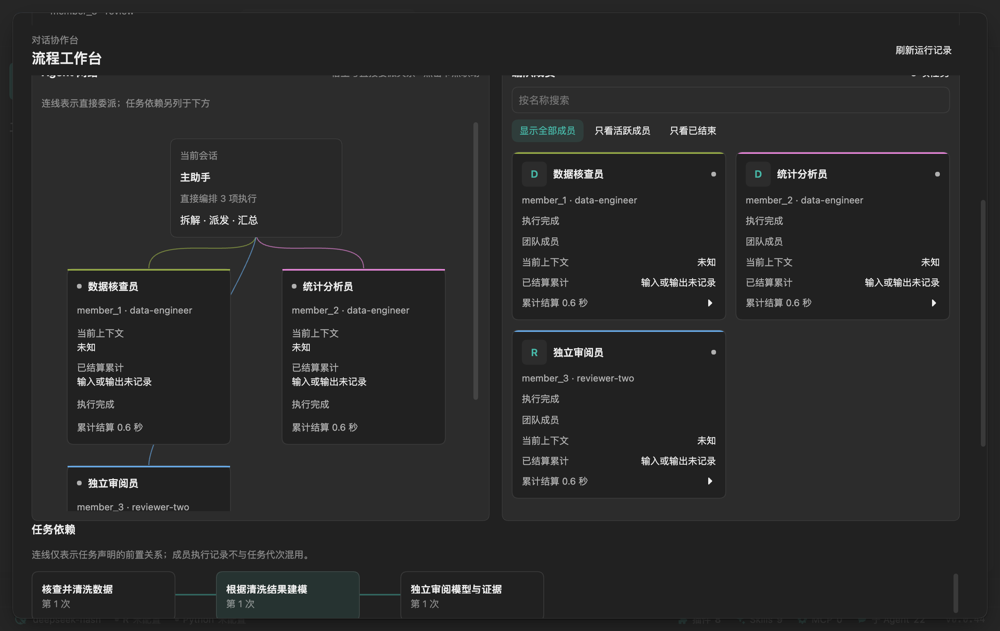
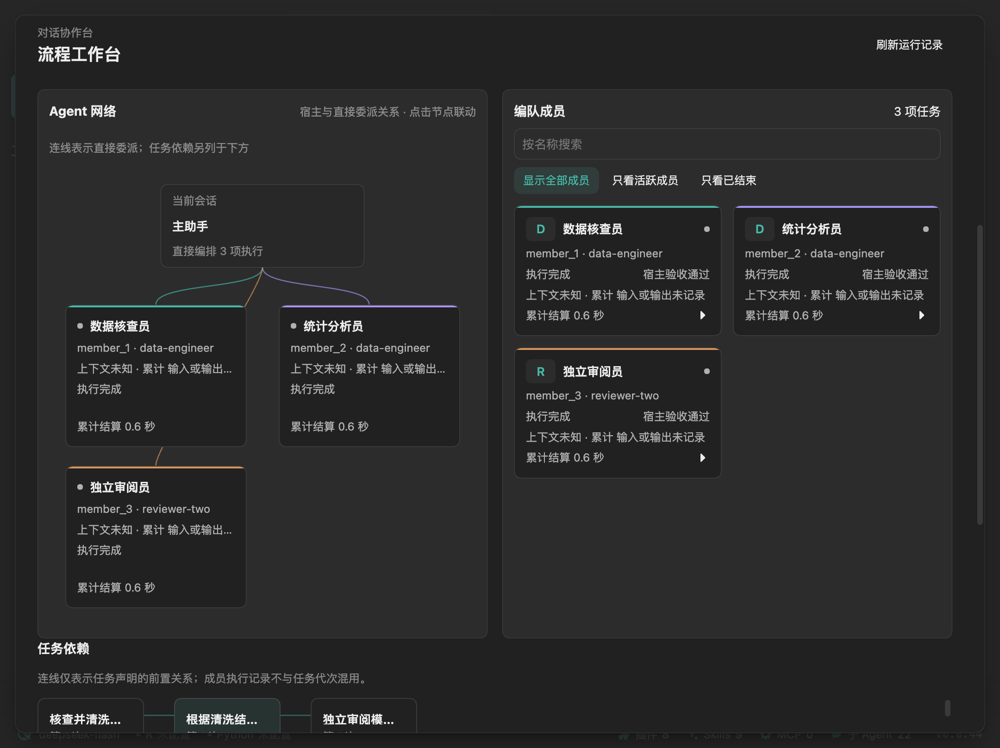

# 紧凑布局实际前后对照

同一套批准三阶段任务的真实Electron夹具；上图是阶段B完成后、紧凑布局实施前，下图是最终候选。窗口宽度不同，不作像素级截图差分或耗时比较。节点高度的代码变化为226→154 CSS px；未知用量仍未知，精确身份与详情入口保留。

实施前：

实施后：

最终候选还显示当前代次的“宿主验收通过”，与“执行完成”分开。真实八成员与900px窄窗见README，不将本地假推理夹具当成真实模型质量收益。
