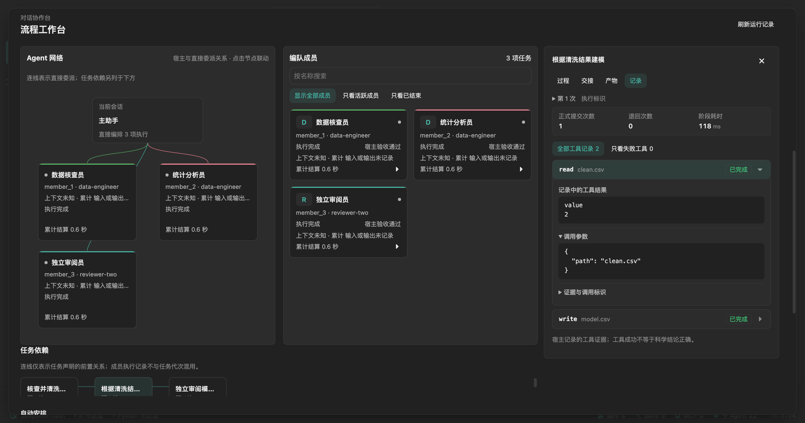
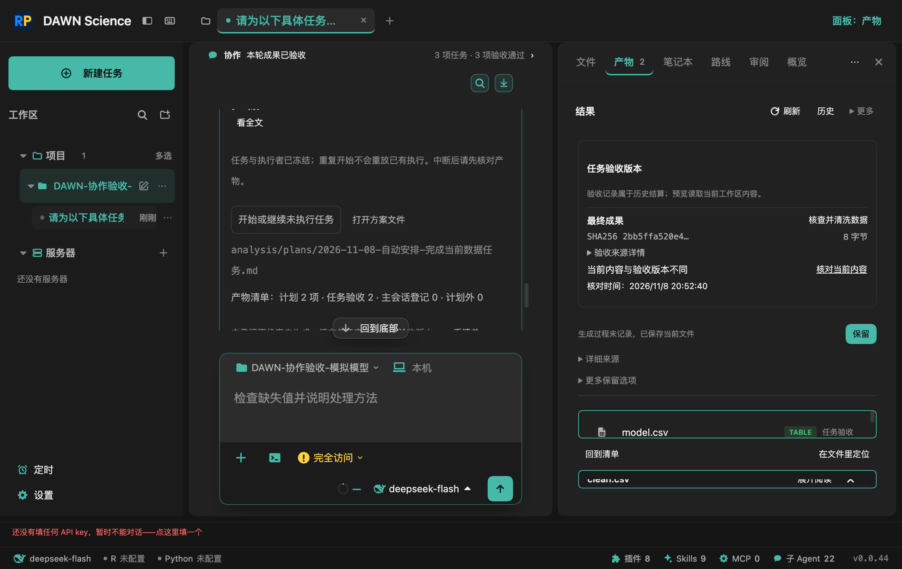

# 合并前复核与隔离演示（2026-11-08）

范围：本地 main `646bcc1a` 到 `codex/delivery-convergence-20261108` 候选。用户已明确授权审查、修复、本地提交并合并；不推送、不发布、不替换正式 App。最终演示使用 main 构建、隔离数据库/配置/模型/工作区及 localhost 模拟模型，不读正式凭证、不新增付费调用。

## 审查与修复

适用审查技能要求独立复核，因此请 `delivery_merge_review` 只读审查；实施及验证由主线完成。两次复核确认下列问题均已解决，无剩余 P1/P2 阻塞。审查覆盖预算分区与预占、会话/执行代次、产物来源与版本、原始工具尾部、取消和恢复、旧功能入口。

| 发现 | 修复 | 证据 |
|---|---|---|
| P2 自动规划核查任务误用分析模型路由（两者可分别冻结） | 按冻结契约 resultType 同时选择模型映射和阶段指导，不按共享执行者名称猜测 | routes-red.log / routes-fixed.log；三任务复用同一执行者定义，三个模型路由分别断言 |
| P3 实时评测总预算2/3次到宿主启动后才报无效阶段分配 | CLI 构建、Electron与凭证读取前验证阶段分配；通用夹具范围不变 | cli-preflight-red.log / cli-preflight-fixed.log；2/3不构建，4/30/300到达模拟构建入口 |

此前真实模型一轮核查和分析路由相同，不受第一项影响。本轮没有重跑模型或使用剩余额度。

## 最终验证

- `typecheck-final.log`、`build-final.log`：退出0。
- `vitest-final.log`：**705文件，7014通过、11跳过，退出0**。先前收到中断的测试批次保留为 interrupted，不算失败或通过。
- `desktop.log`：**41项 Electron 全通过，3.9分钟**。自动安排、批准方案、旧Plan模式、成员与网络、成果与取消排空、子任务、Bot、科学流水线、两类终端退出重开等入口均在范围内。不是全部919项桌面回归。
- `exit-summary.json`：53个宿主退出码均0，51次有完整 close-requested→child-exit 计时，最大224.298ms；另2次显式退出缺少起点不计算延迟。保留每次原始JSONL，不用本轮正常结果关闭历史偶发问题。
- `premerge-integrity.json`：1710个候选文件、494份此前证据未变；main仍基线且干净；正式配置、凭证、数据库哈希不变。

历史 OS 退出7350/20690ms、长Bot/MCP收尾和PTY清理偶发继续 **OPEN**；1500/4000ms阈值保持不变。

## 已有真实模型证据

本轮付费请求 **0**。此前300次上限实测只用了30次：单12次62.395秒，多18次114.646秒；两组均正式验收，自动规划安排3任务，独立审阅4次。三份输出与独立算术复核一致。只有一题一次配对，不能宣称多Agent更快、更省或普遍更准确。

见 [300次上限报告](../research-budget-300-20261108/README.md) 和 [此前实现报告](../delivery-convergence-20261108/README.md)。旧文中的“未提交/未合并”是当时快照，本轮集成以本目录后续记录为准；保留原始证据字节。

## 隔离演示入口

构建完成后，从 main 运行：

```sh
node /Users/liuyue/Desktop/Github_repos/dawn-science/docs/validation/delivery-convergence-merge-20261108/launch-demo.mjs
```

会打开一个单独的开发版 Electron，使用“本地模拟模型 · 不联网”。工作区名称也标明模拟。自动安排、真实文件工具、宿主验收和版本核对使用实际实现；模型输出为本地夹具，不代表新增真实模型效果。关闭窗口即结束；不清理其他工作树、正式数据或本轮证据。交互验收清单见 [qa-inventory.md](qa-inventory.md)，实拍与合并记录在后续文件中。

## 实际交互发现的补修

首批已本地快进到 main `db07895f`。随后实际取消演示发现一个展示遗漏：已暂停且在途0，下游pending任务仍使整体成果显示“协作进行中”。`07-cancel-drained.png`保留修复前现场。

先补三项测试复现（paused-outcome-red.log：2失败/59通过），再修正共享只读投影：暂停状态不能由尚未执行的任务覆盖；精确绑定当前taskAttempt的真实running/queued/stopping进程仍优先显示实际状态，无进程则“协作需要核对”，恢复历史仍只读，不伪造取消或排空证明。逐任务验收与文件内容核对规则保持原样。

独立审查者再次只读复核：无P1/P2阻塞。补修后typecheck/build退出0；成果投影/UI/产物专项4文件93项通过，后端/主产物/批准方案3文件62项通过。桌面补充取消与恢复断言，完整结果见paused-desktop.log。上方7014全量与41项桌面是补修之前的基线，不冒充补修后全量。

交互脚本环境/定位问题及中断如实保留在[运行说明](interactive-harness-notes.md)，不以错误选择器调整产品。

补修后最终完整重跑：**705文件，7017通过、11跳过，退出0，174.29秒**（vitest-postpause-final.log）。相关桌面补充 **4/4通过**（47.4秒）；8个补充宿主退出码均0，完整计时最大167.409ms（paused-exit-summary.json）。这些是补修后最终证据；此前7014与41项保留为基线。

## 最终main实际效果与交付

本地main实现提交`3de8c0ed`（首批`db07895f`，随后暂停展示补修）。main重新构建退出0。

[实际交互结果](interactive/result.json)：原生启动1280×808；自动安排样例生成3项，三项宿主验收通过，2份验收文件。完成后重复开始没有新增任务调用。原始read记录的参数/结果分栏，准确宿主尾部没有混入结果。展开返回保留记录页。核对文件依次显示一致、修改后不一致、恢复后一致。新会话无旧验收文件。

实际取消后排空且pending下游未启动；重开显示“协作需要核对/执行已暂停”。正常关闭main开发版172ms，app诊断exitCode0；再次重开保留3个验收回执和暂停会话。契约任务调用前后都是9次，无自动重跑。总模拟调用还包含既有“建议下一句”请求，不把所有UI辅助调用误当作任务执行。900px宽窗口对话框clientWidth=scrollWidth=856，未发生横向溢出。

最终窗口保留可操作，工作区明确名为“DAWN-协作验收-模拟模型”；模型为localhost夹具，Electron、文件工具、契约、宿主回执与内容核对是真实实现。不是新增真实模型复验。按Escape可返回对话协作台；关闭此演示窗口会关闭其独立宿主和本地模拟服务，保留自己的隔离证据。





[最终保护核对](postmerge-integrity.json)：1710源文件候选与494份既有证据匹配，正式配置/凭证/数据库哈希未变；实现main干净。全部分支/工作树/原始证据保留。仅本地提交/快进，不推送、不发布、不替换正式App。历史退出与PTY问题OPEN，1500/4000ms阈值不变。
