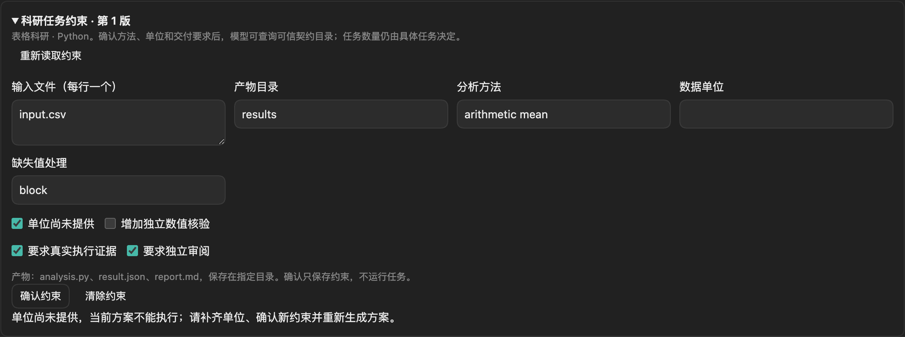

# 本轮实际效果

本地模拟模型负责确定性提案与回执；契约、Electron、进程隔离、Python、输入/产物文件和宿主验收实际运行。真实模型请求0，因此不宣称真实提问率或费用已经改善。

## 已确认条件直接提供给规划

工具层演示的可信来源明确列出arithmetic mean、mg/g、drop NA、输入与产物目录；missingFacts=[]。显式标记单位缺失时units=null、missingFacts=[units]，不把未知值伪装成单位。真实冲突或缺项仍可提出问题，不按关键词删问题。

[实际工具输出](tool-effects.json) · [可重放工具探针](probe.ts)

## 依赖错误在提交阶段返回

实际输出：

> 任务安排无效：任务 review 读取产物 result.csv 必须声明生产任务 analyze 的前置依赖；请修正 arrangement 后重新提交，当前方案未保存。

该调用后保存数0；补上依赖后保存数1。没有自动补边、修改科学合同或批准执行。

## 缺单位先停下，补齐后新方案执行

桌面案例：输入x=1,2,3，起初明确缺单位。确认只保存缺项，方案等待补信息、无法批准，三个科研产物不存在；重启仍保持缺项。补m、确认新修订并重新生成/采纳后，真实Python输出：

```json
{"n":3,"mean":2.0,"unit":"m"}
```

分析和独立审阅分别通过宿主验收，输入原字节保留。此前的缺单位方案不会自动执行。



[重启后仍缺单位](desktop/restored-missing-unit.png) · [补齐后分析和审阅均通过](desktop/new-confirmed-proposal-accepted.png) · [实际结果文件](desktop/actual-result.json)

## 评测与审查

最终733个测试文件通过，7166项通过、11项跳过、0失败；类型检查和构建通过。9项相关Electron通过，补齐界面格式和英文文案后再通过2项科研路径。详见final-verdict.json与专项审查。

现有离线入口保留12组：5个数值题配对合格，缺单位两组均awaiting-info、不算合格配对或正确科学blocked；单执行者0次模型请求、自动规划2次localhost请求，均无科研产物。12个输入/文件检查通过，离线门72次请求、最终在途0；这些不是联网模型调用或费用收益。

[离线摘要](fixture-summary.json) · [专项审查](../../reviews/2026-11-10-planning-readiness.md) · [候选身份](candidate.json) · [退出记录](exit-summary.json)

main和正式App保持不变；专项工作区保留，未提交/合并/推送/发布。历史退出超时、长Bot/MCP收尾及PTY清理继续OPEN。
