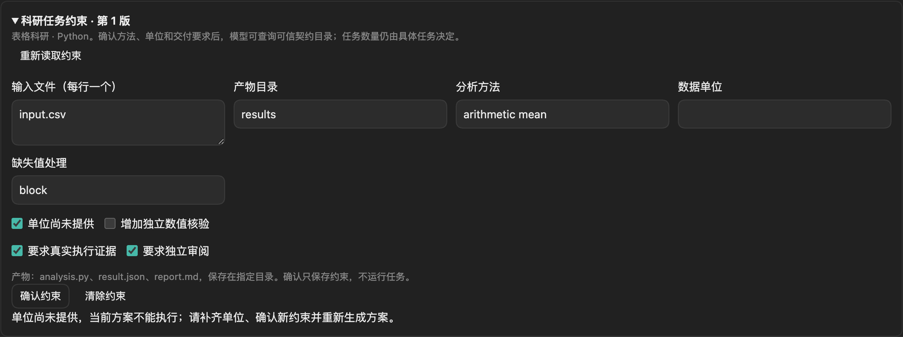
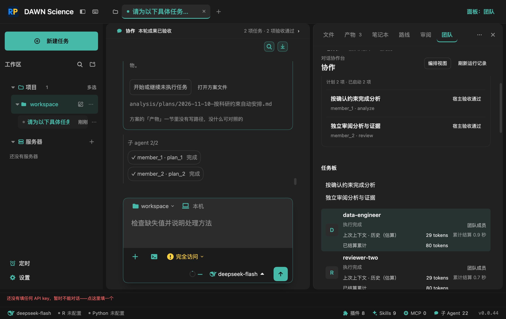

# 本轮可核对的实际效果

本轮复用原专项候选，并修复“缺单位状态仍隐藏保留旧单位”的遗漏。main 与正式 App 不变，所有展示来自隔离候选。没有调用真实模型；工具、Electron、Python、输入文件和宿主验收的证据分别记录。

## 阶段一：已知条件直接提供，依赖错误提前反馈

实际调用见 [tool-effects.json](tool-effects.json)：已确认 method、units、missingValues、inputs、outputRoot 明确提供给规划，missingFacts 为空；显式缺单位时 units 为 null、missingFacts 为 units。共享指引保留真实缺项和冲突，不删除模型问题或自动批准。

缺依赖的提案返回：

> 任务 review 读取产物 result.csv 必须声明生产任务 analyze 的前置依赖；请修正 arrangement 后重新提交，当前方案未保存。

该调用保存数 0；补齐依赖后的保存数 1。以上是实际工具调用，不能据此宣称真实模型的提问率已经降低。

## 阶段二：缺单位执行前停止

[实际宿主输出](unit-effects.json) 使用自制 CSV：另一任务仍持有输出锁，缺单位任务直接 blocked；子进程启动 0，新科研文件 0，原输入保持字节一致，没有等待到取消才停。探针在 finally 中释放自建锁并清理隔离目录。

本轮新增修复：旧单位 m 被标记缺失后清空；解除标记仍为空，必须填写新单位。即时操作、重挂载和旧草稿恢复均有红绿反例，见 unit-reentry-red-final.log 和 stage-two-tests.log。补 cm 并确认后才形成新来源，不修改已冻结任务。

## 阶段三：桌面执行与返回

桌面输出在 desktop/，测试运行证据在 desktop-results/。所有环境使用夹具隔离配置、数据库、user-data、工作目录及技能/记忆路径；模型服务仅为 localhost 模拟服务。Python 数值计算及宿主验收实际执行。

## 保护与保留问题

历史偶发退出超时、长 Bot/MCP 收尾和 PTY 清理保持 OPEN，不用正常样本关闭。没有放宽预算，也不自动重放副作用。源码身份见 candidate.json；本轮相对复用候选的新变更见 new-changes.json。测试、桌面结果和收口身份将在 final-verdict.json 中汇总。

## 本轮验收结果

- 733 个代码测试文件，7169 项通过、11 项跳过、0 失败；类型检查、构建通过。
- 8 项相关 Electron 全部通过。真实 Python 结果为 `{"n":3,"mean":2.0,"unit":"m"}`，分析和独立审阅均通过宿主验收。已实际阅读以下两张截图。
- 14 次正常退出观察最大 182.01ms，无诊断告警；历史退出超时、长 Bot/MCP 收尾和 PTY 保持 OPEN。
- [验收结论](final-verdict.json) · [实际结果](desktop/actual-result.json) · [退出记录](exit-summary.json) · [源码与构建身份](candidate.json) · [代码审查](../../../reviews/2026-11-10-planning-readiness-followup.md)

缺单位时明确不能执行：

补齐后新方案实际执行并获得双验收：

main、已安装 App 不变；保留专项工作区，未提交/合并/推送/发布。真实模型调用为 0，没有使用旧额度，提问率和费用收益仍未真实复验。
