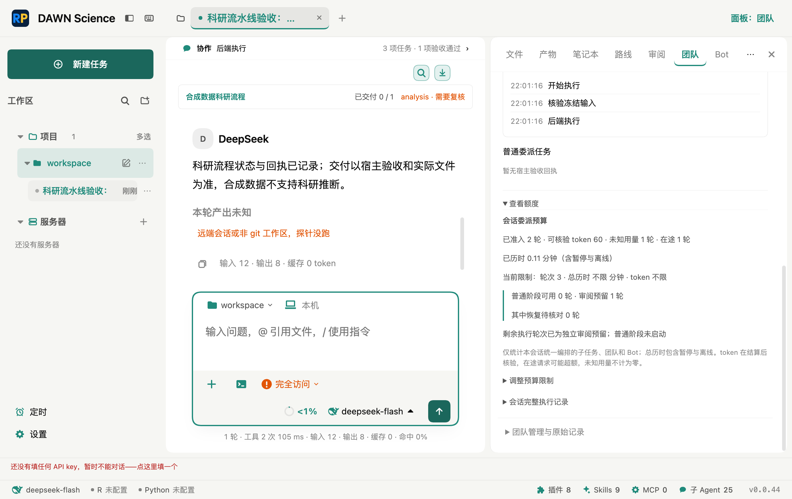
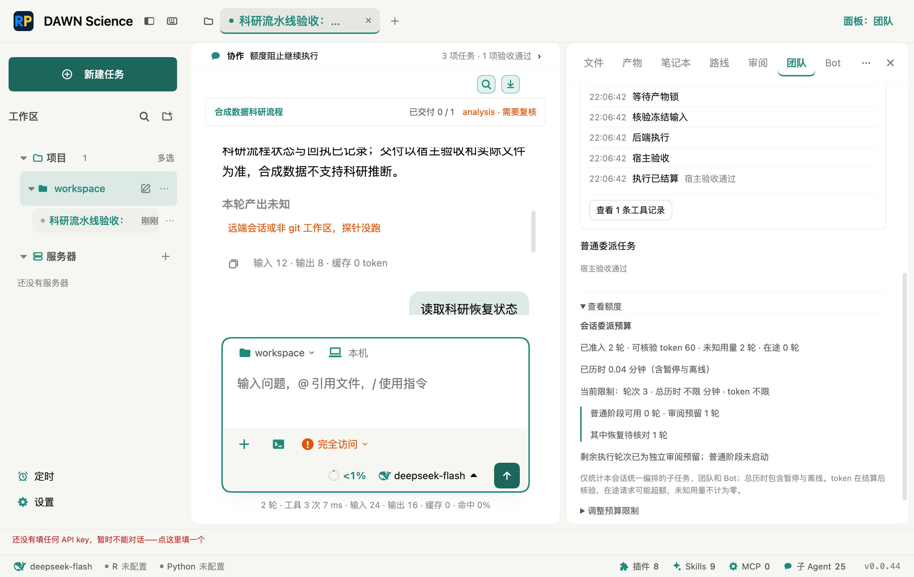

# P2 正式审阅轮次预留：本地验收完成

正式任务沿用同一 OrchestrationStore 原子预算账本、冻结任务、产物锁和恢复机制。新增策略默认关闭；启用须设置执行轮次上限。预留的是每个科研周期的一次审阅准入，不是模型请求或 token 额度，也不保证科学结论正确。

| 实际效果 | 验证 |
|---|---|
| 普通可用 0、审阅仍保留 1 | 真实 Electron/Pi：总额 3 轮，核查、分析、独立审阅全部完成；重启后已用仍为 3。 |
| 取消排空后释放未用预留 | 真实慢工具触发 6 秒历时限制，分析进程退出；在途 0、预留 released/0，已用 2 轮保留。 |
| 中断后核对再恢复 | 分析中断、Electron 重开；已用 2 轮、预留 recovery-check/1，没有自动重跑。用户核对并将上限 3 调至 4，再显式恢复，最终完成且累计 4 轮。 |
| 并行不足时不浪费前序轮次 | 宿主集成回归：两条三阶段周期总额 4/5 时后端调用为 0，6 时正常准入；后续周期计入其他活动检查点的剩余需求。固定宿主汇总仍使用普通预算。 |
| 审阅已消费后崩溃 | 宿主集成回归：不退款；核验后为新恢复代次重新核算，仅审阅重试需要 1 轮，保留科学修订 round。 |
| 释放保存失败、策略关闭 | 终态释放失败后可显式重复取消进行核对；仅排空后释放。关闭策略后已消费历史不阻止无限额普通恢复，未用预留仍受保护。 |

上述推理均为本机夹具；进程、文件执行、宿主契约和版本验收是真实链路。不能据此推断真实模型质量或费用收益。

## 验证结果

- [完整 Node/UI](evidence/budget-ui/b-final-node-ui.txt)：**6586 通过、10 跳过，657 文件通过**。首轮 6574 通过、3 个 UI 契约失败已原样保留在 `b-full-node-ui.txt`，随后修复，不修改测试阈值。
- [构建](evidence/budget-ui/b-final-build.txt)、[类型检查](evidence/budget-ui/b-recovery-typecheck.txt)通过。
- [相关 Electron 9/9](evidence/desktop/final-tests.txt)，另补[中断恢复 1/1](evidence/desktop/recovery-green.txt)。新增案例首次失败记录保留；恢复案例的初次失败来自夹具没有状态/恢复口令分支，补上后仍通过真实工具调用和 CAS。
- 后补恢复用例仅改测试和合成推理夹具；[源指纹](candidate-sources-after-recovery.json)确认 `src/` 产品实现与完整回归时相同；夹具相关 9 项测试另通过。
- 独立规格和质量复审最终均无阻断。审查修复的状态一致性、在途前序、策略关闭恢复、释放失败补偿、并行最低容量均有先失败后通过的回归。

## 查看实际界面与账本

普通阶段额度为零时，审阅仍保留一轮：

重启后预留进入待核对，显式恢复才继续：

[三轮完成及重启账本](desktop/review-reservation-ledger.json)、[取消排空账本](desktop/review-cancel-drained.json)、[中断恢复账本](desktop/review-interrupted-recovery.json)。图片中的配置提示来自隔离测试环境，不是用户正式 App 状态。

## 历史退出跟踪

[13 次实际 OS 退出记录](exit-summary-after-recovery.json)均正常完成，无诊断迟延事件；本次通过不解释或消除历史 7.35 秒/20.69 秒延迟。历史问题保持 **OPEN**，1500/4000 毫秒预算未改变。原始主进程/观察者 JSONL 均保留。

本阶段未运行 kernel 或全量桌面套件，未验证 Windows/Linux 或真实模型收益。未提交、未合并、未推送、未发布，未替换正式 App 或修改正式配置/凭证/数据库。

补核：并行桌面用例原默认输出指向旧阶段目录，本轮四份生成物已[单独归档](desktop/parallel/)，旧目录按 Git 原文逐字节恢复，[恢复哈希](historical-evidence-restore.json)保留。测试默认输出已改为 Playwright 本次用例的 evidence 目录；[再次运行通过且历史四文件未变](evidence/evidence-isolation/verified.json)。这只修改测试证据路径，没有改变产品逻辑。
