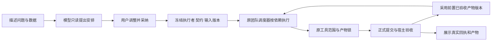

# 任务安排与成员会话

已有自动安排与成员入口已在本地 main（代码提交 dacd7838）。本文新增的“批准方案执行绑定”位于 `codex/plan-execution-workbench-20261108` 专项工作区，尚未提交或合并。均未推送、发布或替换安装版，不表示已安装的 0.0.44 已包含这些变化。任务块数仍由具体任务决定。

## 自动安排具体任务

打开右侧「团队」协作台，默认看到「自动安排」。可以直接描述目标，也会带入这段会话已有的任务草稿。说明数据、希望得到什么、限制与审阅要求即可，不需要先填任务块数。

点「生成安排」后，DAWN 先进入现有只读方案模式，由当前会话模型结合具体任务与可读取信息决定拆分、分工和依赖。模型交回后显示方案结果中的任务数、方式、理由及每块目标、角色、文件、依赖和验收条件。任务数不是 Agent 数，提议角色也不表示已经启动或获得执行权限。

| 任务例子 | 可形成的方案 |
|---|---|
| 一个明确的均值计算 | 一块任务，避免不必要交接 |
| 分别处理两个独立数据集 | 可独立分工，使用分开的输出 |
| 清洗后建模，再独立审阅 | 按结果依赖安排，审阅单独分工 |

这不是固定模板。具体数量和安排来自模型提交的方案，缺少信息时列出待确认项；没有 valid 方案时不会编造一个任务数。

## 调整和采纳

生成后先显示结果，展开「调整任务与分工」可补充自然语言要求，例如「合并前两步，保留独立审阅」，再点「重新安排」。模型交新版后，数量和分工随新结果更新，旧版保留为已取代记录。

也可以在对话的方案卡点「改一改」，编辑可读的任务说明、角色和依赖。界面从修改后的正文重算数量；任务 ID/依赖错误或取消了已有独立审阅要求时，会提示修正并阻止采纳。原来没有任务安排节的方案仍保留原来的编辑方式。

确认后点原方案卡「照这个做」或「照改过的做」：先保存方案和指纹，再进入既有执行流程。待确认问题未解决时不能批准。执行继续受原权限、冻结契约、预算、产物版本、产物锁和恢复检查约束。

新可执行安排明确列出每项执行者和访问范围。采纳时冻结这些选择、完整方法上下文、契约与外部输入内容版本，随后直接进入既有 Team 调度器；不会再发一句话让模型重新分工。启动失败时，已批准方案保留，可以核对原因后点「开始或继续未执行任务」。旧方案继续沿用原执行方式，不冒充已绑定任务。

「批准方案执行进度」显示计划与实际任务的对应关系，区分计划数、实际启动数、前置阻塞与验收结果。新绑定目前支持本地 Native 与现有本地子 agent，最多 8 个执行成员；超出容量或能力不足时要求调整，不会截断任务或放宽权限。科研专用流水线及原入口继续保留，本轮没有另建调度引擎。

执行中点「停止本方案执行」，只停止所属方案团队，等待旧进程排空。重开保持暂停，查看页面不会自动执行。没有副作用不明的失败尝试时，可显式继续未执行任务，并重新核验文件版本；存在中断/失败尝试时先检查产物，点「结束此安排」保留旧任务记录，再提出新安排。结束不会删除输入或产物。冻结成员和依赖不能通过旧 Team 的增任务/转派入口改写，调整须重新批准。

变更文件或契约时，推荐用自然语言重新安排；原文编辑里的文件声明与执行契约会核对一致性，不能只改路径而保留矛盾契约。

任务正在执行或排空时，新安排入口不可启动。可以「中止规划」取消本轮规划；不采纳已完成的方案仍使用原方案卡「不做了」。重启后方案版本与任务结果能从原会话恢复；未发送的本地输入草稿不因此获得额外持久化保证。

自动安排使用任务文字及会话已提供的上下文。未发送的附件应先在对话里提供，或引用工作区中实际存在的文件；缺少数据时先补信息。这里只支持已有只读方案能力的内置模型会话，其他运行时会说明限制。

## 查看成员并返回

点协作任务或展开流程工作台的成员卡，在原四个详情页下方看「成员会话与操作」。

| 成员类型 | 能看什么 | 操作路径 |
|---|---|---|
| 普通子任务 | 原始过程、工具行和交回结果 | 「查看子任务过程」进入已有面板；续问、纠偏、停止由宿主当前能力决定 |
| 旧 Team 成员 | 精确关联角色、任务和成员邮箱 | 邮箱明确不是完整逐步转录；可准备给所属队长的指令草稿 |
| 新绑定安排成员 | 冻结分工、对应任务、状态与验收版本 | 从进度或成员卡进入原四个详情页；停止/结束走本方案入口，改分工重新提案 |
| Bot 成员 | 已启动的成员只读执行对话 | 「打开成员只读对话」；发言和停止仍走原团队/任务入口 |

从协作台进入成员过程/只读对话时，可「返回协作台」。保留原成员、详情页与展开状态；原入口进子任务仍然「回到清单」。如果会话离开可见范围、从其他入口打开或重启，旧返回来源不会落盘恢复。

旧成员代次不能借用同名新成员的邮箱、角色或 Bot 会话。记录缺失时界面说明原因，不猜测当前状态；侧边会话的 Bot 打开能力本轮未接入，明确不可用。磁盘快照只读，看到历史完成不代表任务正在运行或可以自动恢复。

「过程」「交接」「产物」「记录」「团队管理与原始记录」、原子任务和 Bot 入口均保留。

## 验证边界

已有 main 的自动安排使用契约评测、真实 Electron 与 localhost 确定性夹具，历史证据见[自动安排验证](validation/auto-arrangement-20261108/README.md)和[原成员入口验证](validation/mode-member-workspace-20261108/README.md)。

本专项另验证真实子进程绑定执行、取消、重开、产物版本与成员展示。新增真实 API 试验实际使用 25/30 次：单执行者 14 次通过，多执行者耗尽 11 次核查/分析额度后未完成正式交付，独立审阅 4 次未借用。没有证据宣称多 Agent 更快、更省或科研准确率更高；真实试验固定科研任务用于测执行适配器，不代表产品固定三块，也不测模型自动拆分质量。见[专项结果](validation/plan-execution-workbench-20261108/README.md)。历史偶发退出超时继续 OPEN。

本轮复审补齐停止确认门闩、取消后重启等待与旧 Markdown 缩进示例兼容。main 实际界面及验证见[本地集成记录](validation/auto-arrangement-merge-review-20261108/README.md)。
